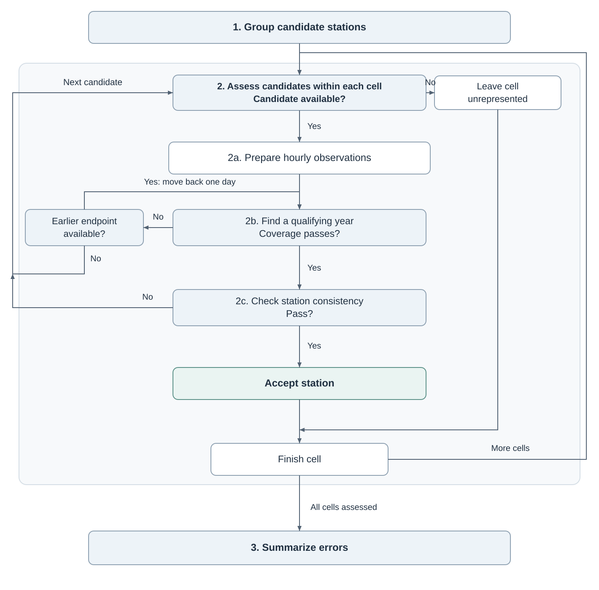
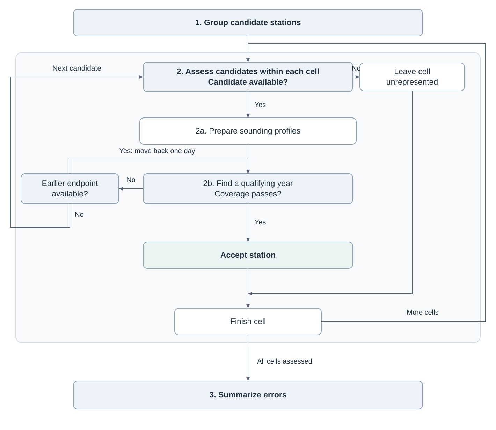

# Appendix S1 — Reference-station selection and processing

**Author-approved process draft.** Both selection processes are implemented. The IGRA [implementation and pilot report](../methods/igra-sampling-review/implementation.md) records the numerical and recovery checks; the [preceding assessment](../methods/igra-sampling-review/assessment.md) contains the design rationale. This text is ready for integration when the full selections and resulting manuscript analyses are completed.

---

## S1.1 GHCNh station selection

We use station pressures and reported elevations from NOAA's Global Historical Climatology Network hourly archive (GHCNh) [@ncei_ghcnh]. We select one station per represented grid cell through the process shown in Figure S1a. Here, an altitude discrepancy is the ERA5-standard estimate minus the reported station elevation.

1. **Group candidate stations.** We consider observations from 1 January 2022 through 12 October 2026 (UTC) and group stations into 200 × 200 km equal-area cells using the Equal Earth projection (EPSG:8857). Candidates must have coordinates, a reported elevation and data within this period. We assess them in random order within each cell.
2. **Assess candidates within each cell.** We select the first station that passes the following checks. If a candidate fails, we assess the next; if none passes, the cell remains unrepresented.
   - **2a. Prepare hourly observations.** We retain pressures between 300 and 1100 hPa that pass the source-quality exclusions.[^pressure-quality] We assign each report to the nearest ERA5 hour and, where several reports share an hour, retain the one closest to it. We match these observations to surface pressure, 2 m temperature, dewpoint and orography at the nearest ERA5 grid cell, retaining observations with complete inputs.
   - **2b. Find a qualifying year.** We search backwards from the end of the study period in daily steps for the latest qualifying 12-month window. Within each window, we remove discrepancies more than both 100 m and ten scaled median absolute deviations (MAD) from its median. We then require at least 15 days with four accepted hours in each of the 12 month-long intervals measured backwards from the window endpoint. All remaining observations in the qualifying window are retained.
   - **2c. Check station consistency.** We reject a station if any of these conditions holds:
     - Extreme outliers account for more than 1% of the matched observations before their removal.
     - Its absolute mean discrepancy exceeds 30 m plus 10% of the absolute station–ERA5 elevation difference.
     - Its discrepancy shows a season-adjusted step of at least 10 m with an absolute step score of at least 10, or its history is insufficient for this check.[^step-check]
3. **Summarize errors.** We evaluate all three conversions using the same accepted observations.
   - **Station summaries.** We calculate each station's mean signed error (bias) and SD, then summarize these metrics across stations with equal station weights.
   - **Observation summaries.** We calculate the median and 95th percentile of individual absolute errors from the pooled observations. Each station receives equal total weight, shared equally among its accepted hours.

[^pressure-quality]: We exclude pressures identified as suspect, erroneous, removed or failing archive checks according to NOAA's [source-specific quality-code definitions](https://www.ncei.noaa.gov/oa/global-historical-climatology-network/hourly/doc/ghcnh_DOCUMENTATION.pdf). Other and missing quality codes are retained.

[^step-check]: A step is a persistent shift in discrepancy after accounting for seasonality. We use up to three years ending at the selected window endpoint and apply the outlier rule to this history. We calculate calendar-month medians from months with at least 60 accepted hours and require at least 18 medians spanning all 12 calendar months. We fit month-of-year effects and a single shift, choosing the breakpoint within the selected window that minimizes residual variation, with at least three monthly medians on each side. The step score is the fitted shift divided by its standard error; it serves as a screening score rather than a calibrated significance test.

**Figure S1a.** GHCNh selection. The numbered boxes correspond to the steps above. An unsuccessful observation window moves the search back one day; a rejected candidate advances the search to the next station in its cell.

## S1.2 IGRA sounding selection

We use pressure and reported geopotential-height profiles from NOAA's Integrated Global Radiosonde Archive (IGRA2) [@durre2006; @durre2018; @igradocumentation]. Each sounding includes a ground-level record at launch, which provides the surface reference for the ascent. Flight-height errors compare the estimated and reported height gain above this reference.

1. **Group candidate stations.** We use the study period and spatial grouping procedure in S1.1, assessing stations in random order within each cell (Figure S1b).
2. **Assess candidates within each cell.** We select the first station with a qualifying year of usable soundings. If a candidate fails, we assess the next; if none passes, the cell remains unrepresented.
   - **2a. Prepare sounding profiles.** We require a valid surface pressure and airborne pressure–height pairs up to 6 km above the launch surface. If the surface height is missing, we use the station elevation; we exclude soundings whose surface pressure or height was rejected by archive quality control. We match each airborne observation and its surface record separately to ERA5 using their observation times and the launch location. Reported launch and ascent times determine these times; missing launch times use the nominal time, and missing ascent times are estimated using a 5 m s$^{-1}$ ascent rate. We retain pairs with complete inputs for all three conversions.
   - **2b. Find a qualifying year.** We use the daily backwards search described in S1.1, assigning soundings to windows by launch time. Within each station and height band, we remove ERA5-standard errors more than both 150 m and ten scaled MAD from the window median. We then require at least 15 launch dates with an accepted airborne observation in each of the 12 month-long intervals. We retain all accepted airborne observations and their surface records from the latest qualifying window.
3. **Summarize errors.** We evaluate all three conversions using the same accepted observation pairs.
   - **Station summaries.** We calculate bias and SD within each station and height band, then summarize these metrics with equal weights among contributing stations.
   - **Observation summaries.** Within each height band, we calculate the median and 95th percentile of individual absolute errors. Each contributing station receives equal total weight, shared equally among its accepted airborne observations.

**Figure S1b.** IGRA selection. The numbered boxes correspond to the steps above. An unsuccessful observation window moves the search back one day; a rejected candidate advances the search to the next station in its cell.

---

## Supplement integration plan — outside publication text

| Destination | Contents |
|---|---|
| **S1 Reference-station selection and processing** | **S1.1 GHCNh**, then **S1.2 IGRA**: the two numbered processes above and their corresponding flowchart panels. Counts can be placed on the flowcharts after selection finishes. |
| **S2 How the error varies** | Retain the current environmental profiles without adding the ground- and flight-error tables. Full error summaries and height-band support remain in the accompanying data. |
| **S3 ERA5 single-levels and ERA5-Land** | Retain the product comparison. |
| **S4 Ground-reference height and selection** | Proposed: group the GNSS and MeteoSwiss evidence around the reference-height question, followed by a focused GHCNh selection comparison. See the [restructuring proposal](supplement-s4-restructure-2026-10-20.md). |
| **S5 Flight-height weighting** | Proposed: place reference-profile and biological weighting methods/checks together, supporting the flight-time summary and its limits. |
| **S6 Horizontal-position sensitivity** | Proposed renumbering of the existing S5 experiment; its content is retained. |

The two error tables have been removed from `paper/supplement.qmd`, and their main-text S1 pointers have been removed. S2 remains unchanged. Apply the proposed S4–S6 structure and update its main-text pointers when agreed and when the new selections are integrated. The data-availability statement should distinguish S1's primary processes from S4's complementary references. The new flight inputs use a first height band of (0, 100] m; generated data labels should reflect that boundary.

Keep the interpretation of geopotential-height provenance, balloon drift, assimilation and residual-based selection with the relevant limitations in S4/main Discussion. S1 describes the operations needed to obtain the comparison inputs. Source temperature interpolation for the layer-temperature explanation is described beside that analysis, rather than being an additional input requirement for every flight comparison.

### Hourly report selection — author-facing implementation note

The approved rule selects the accepted report closest to its assigned ERA5 hour, with earlier reports resolving equal-distance ties. GHCNh settings now identify this as version 2. Pressure caches, selection checkpoints and accepted series from the first-report rule are kept separately, and selection is recalculated using the frozen candidate order and existing archive/ERA5 caches. Manuscript summaries will use the completed version-2 selection.

The station and observation summaries answer different questions. Station bias/SD are calculated within stations and then summarized across stations. Individual-error quantiles come from the weighted pooled errors. These summary operations remain to be connected to the final accepted inputs in the downstream manuscript analysis.
