# How accurate is altitude from pressure geolocators?
Raphaël Nussbaumer, Mathieu Gravey
2026-10-16

# Abstract

Pressure geolocators reveal the altitude of a bird by converting the pressure it records into height. GeoPressureR does so with the barometric equation, taking the surface pressure, 2 m temperature and orography of the ERA5 reanalysis as reference. We describe this conversion and evaluate it, assuming a perfect pressure reading, against 2,502 HadISD weather stations worldwide, 47 GNSS and 138 MeteoSwiss stations with documented barometer heights, and 648 IGRA2 radiosonde stations up to 6 km above the ground. On the ground, the median station has a constant bias of 2.5 m and a scatter (SD) of 3.6 m around it, but the bias exceeds 11.4 m at 10% of the stations. Both grow with the gap between the station and ERA5’s smoothed terrain, while season, time of day and climate matter little, and stations never assimilated by ERA5 give similar figures. In flight, the formula used up to GeoPressureR v3.6 underestimates the height above the ground by 1–1.5%, because it assumes a column that is too cold; over the heights birds fly, its mean absolute error (MAE) is 16.4 m. Using the virtual temperature and the lapse-rate climatology of the GPT3 troposphere model, the default from v3.7.0, removes most of this bias (MAE 13.1 m on held-out stations, as good as a lapse rate fitted to the radiosondes) and changes the ground altitude by less than 1.1 m at 90% of the stations. The remaining in-flight scatter follows the day-to-day temperature profile, which no formula based on the surface alone captures. ERA5-Land is about four times less accurate on the ground and should not be used for altitude. A geolocator’s own sensor error adds to these figures, mostly to absolute altitude.

# Introduction

Knowing the altitude of a bird matters both on the ground and in flight. On the ground, altitude constrains where the bird is: comparing it with the terrain refines a position that pressure alone resolves only coarsely (Nussbaumer et al. 2023a), and it describes the habitat used, as in the uphill roosting movements of Alpine-breeding wheatears (Rime et al. 2023). In flight, altitude reveals how birds use winds and temperatures aloft and cross ecological barriers (Sjöberg et al. 2021; Dufour et al. 2026), and how often they fly through the height band of wind turbines (Cleasby et al. 2015; Johnston et al. 2023; Doniol-Valcroze et al. 2026).

Small migrants carry no GPS, but multi-sensor geolocators record atmospheric pressure throughout the year (Bäckman et al. 2017; Liechti et al. 2018; Sjöberg et al. 2018; Rhyne et al. 2024), and even on larger birds barometric altimetry is often preferred to GPS heights, which are noisier (Lato et al. 2022; Schaub et al. 2023). Pressure, however, is not altitude. Converting one into the other needs a reference level, where both pressure and altitude are known, and a temperature for the air between that reference and the bird. Both vary in space and time, and errors in either propagate into flight-height distributions and the ecological conclusions drawn from them (Poessel et al. 2018; Péron et al. 2020).

Two kinds of reference are used. The first is a local calibration, where the bird is known to be at a given height: the sea surface for seabirds (Cleasby et al. 2015; Johnston et al. 2023), or the ground during resting periods. The second is a weather model, which gives the pressure and temperature at the ground anywhere and at any time. Schaub et al. (2023) took the reference from the ERA5 reanalysis, with a lapse rate from the lowest ERA5 pressure levels, and found barometric heights of grounded raptors 5–15 m below the terrain. GeoPressureR, which reconstructs the trajectories of birds carrying pressure geolocators (Nussbaumer et al. 2023a, 2023b), also takes its reference from ERA5, as GeoPressureAPI does on Google Earth Engine. The same problem has been solved in other fields. GNSS meteorology brings reanalysis surface pressure to the height of each GNSS station, with errors of about 1 hPa (Huang et al. 2023) and with lapse rates that vary with place and season (Böhm et al. 2015; Landskron & Böhm 2018). Aviation corrects pressure altitude for a column colder or warmer than the standard atmosphere, against precise GNSS (Simonetti & García Crespillo 2024).

What is missing is an assessment of the conversion that pressure-geolocator studies actually use, across the terrain, climates and heights that birds experience. Field comparisons are local and short and mix the errors of the sensor, the calibration and the conversion (Lato et al. 2022; Schaub et al. 2023; Johnston et al. 2023). Validations of reanalysis surface pressure, conversely, test neither the temperature assumed above the ground nor the height of the barometers used as reference (Vasiljevic et al. 2006; Haiden et al. 2018).

Here, we describe how GeoPressureR computes altitude (<a href="#sec-altitude" class="quarto-xref">Section 2</a>) and evaluate it against four references of known height: weather stations worldwide, GNSS stations and Swiss stations with documented barometer heights, and radiosondes up to 6 km above the ground. We ask (1) how accurate and precise the altitude is, on the ground and in flight, and what drives its error; (2) whether ERA5-Land, with its finer grid, does better than ERA5 single-levels; and (3) whether a simple change of the formula, cheap enough to run for every point of a year-long track, reduces the error. The answer to (3) became the GeoPressureR default.

# Altitude from pressure in GeoPressureR

## From pressure to height

Pressure decreases with height because each layer of air carries the weight of the air above it. Combining this hydrostatic balance with the ideal gas law gives the exact relationship between pressure and height (Wallace & Hobbs 2006, ch. 3):

$$
\frac{dp}{dz} = -\frac{g\,M\,p}{R\,T_v(z)},
$$

with $p$ the pressure (Pa) at height $z$ (m), $g$ = 9.807 m s⁻² the gravitational acceleration, $R$ = 8.314 J mol⁻¹ K⁻¹ the universal gas constant, $M$ = 0.02896 kg mol⁻¹ the molar mass of dry air, and $T_v(z)$ the virtual temperature (K), the temperature corrected for humidity (below). Pressure drops faster through cold, dense air than through warm, light air. To turn a recorded pressure into an altitude, the equation must be integrated from a reference level up to the bird, which requires the temperature profile in between. It is never known exactly, so every conversion is an approximation.

Altimeters assume a temperature that decreases linearly with height, $T(z) = T_0 + L\,(z - z_0)$, in dry air ($T_v = T$), which gives the barometric equation:

$$
z = z_0 + \frac{T_0}{L}\left[\left(\frac{p}{p_0}\right)^{-R L / (g M)} - 1\right],
$$

with $z_0$, $p_0$ and $T_0$ the altitude, pressure and temperature of the reference level and $L$ the lapse rate. The standard atmosphere takes sea level, 1013.25 hPa, 15 °C and $L$ = −6.5 K/km (ICAO 1993; ISO 1975). It is a global annual mean: weather systems move the surface pressure by tens of hPa, and 10 hPa alone shifts the altitude by about 80 m.

## The reference level from ERA5

GeoPressureR therefore takes the reference level from ERA5 (Hersbach et al. 2020): for a pressure recorded at a given place and hour, $p_0$, $T_0$ and $z_0$ are the surface pressure, 2 m temperature and orography of the nearest ERA5 grid cell (0.25°) and hour. Up to v3.6, the barometric equation was then applied with $L$ = −6.5 K/km in dry air ([`pressure_to_altitude(altitude_formula = "standard")`](https://github.com/GeoPressure/GeoPressureR/blob/main/R/pressure_to_altitude.R)); this is the formula evaluated in most of this report. Along a reconstructed trajectory, [`pressurepath_create()`](https://geopressure.org/GeoPressureR/reference/pressurepath_create.html) reads ERA5 at each position and returns the altitude of every pressure measurement.

## Where the error comes from

The barometric equation is one case of the hypsometric equation, which holds for any temperature profile:

$$
z = z_0 + \frac{R\,\bar T_v}{g\,M}\,\ln\frac{p_0}{p},
$$

where $\bar T_v$ is the mean virtual temperature of the air column between the reference level and the bird, close to the temperature at mid-height. Because the height above the reference level is proportional to $\bar T_v$, an error in the assumed mean temperature becomes the same *relative* error in height:

$$
\frac{\delta (z - z_0)}{z - z_0} = \frac{\bar T_\text{assumed} - \bar T_{v,\text{true}}}{\bar T_{v,\text{true}}}.
$$

A column assumed 3 K (≈1%) too cold places a bird flying 2 km above the reference level about 20 m too low. This is the cold-temperature error that pilots correct for (ICAO 2018). The altitude error therefore has three sources:

- **The reference level.** ERA5’s surface pressure is in error by a few tenths of a hPa (1 hPa ≈ 8 m near the ground; Soci et al. 2024), and its orography is a 0.25° average. A station or a bird in a valley or on a ridge lies tens to hundreds of metres from it, and the barometric equation must extrapolate over this **elevation gap** too.
- **Humidity.** Water vapour is lighter than dry air, so moist air has the density of warmer dry air, $T_v = T\,(1 + 0.608\,q)$, with $q$ the specific humidity. Assuming dry air makes the column too cold by a few tenths of a kelvin in cold, dry air and up to ~3 K in humid tropical air. This is a simplification of the physics, which can be corrected without a free parameter.
- **The lapse rate.** −6.5 K/km is a mean over the whole troposphere. Near the surface, lapse rates vary with latitude and season (Stone & Carlson 1979; Rolland 2003) and are often shallower, e.g. 3.9–5.2 K/km in the Cascade Mountains (Minder et al. 2010), and surface inversions make them shallower still, or reverse them.

Humidity and lapse rate matter in proportion to the height above the reference level, so mostly in flight; on the ground, they only act over the elevation gap.

## The virtual formula, default from GeoPressureR v3.7.0

The analysis of the radiosondes (<a href="#sec-res-formula" class="quarto-xref">Section 4.5</a>) led to a formula that corrects both simplifications at no extra ERA5 cost, now the default (`altitude_formula = "virtual"`):

- $T_0$ is the ERA5 2 m virtual temperature, with $q$ from the 2 m dewpoint and the surface pressure (vapour pressure from Bolton 1980);
- $L$ is the temperature lapse rate of GPT3, the empirical troposphere model of GNSS meteorology (Landskron & Böhm 2018): a mean, an annual and a semi-annual cycle on a 1° grid, derived from ERA-Interim, and interpolated bilinearly at the position and day of year. GeoPressureR downloads the grid once from TU Wien and caches its lapse-rate coefficients, as it does for the ERA5 orography. $L$ is near −6 K/km over most of the world in summer, and becomes shallow or positive in continental and polar winters, when surface inversions are frequent (e.g. +9 K/km in central Siberia in January). Within 0.01 K/km of zero, where the barometric equation is undefined (it becomes the hypsometric equation of an isothermal column), it is set to −0.01 K/km.

$L$ acts here as an *effective* lapse rate: it sets the mean temperature of the column below the bird, not the gradient at any height. We also fitted our own lapse rates to the radiosondes, a constant and one varying with season and latitude (<a href="#sec-res-formula" class="quarto-xref">Section 4.5</a>); GPT3 does as well over the heights birds fly and better above, with no parameter fitted to our data. A lapse rate between the surface and a low ERA5 pressure level (Schaub et al. 2023) would follow the weather, but pressure levels are not in the ERA5 single-levels archive that GeoPressureR reads from ARCO, and reading them would be far slower.

## The sensor

The pressure sensor adds its own error, which is not evaluated here: an **absolute** error (offset), which may drift slowly, and a **relative** error (resolution, noise, temperature sensitivity) on short-term changes. A pressure error $\delta p$ shifts the altitude by $\delta z = R\,T_v\,\delta p/(g\,M\,p)$, i.e. about 8.4 m/hPa near sea level, 10 m/hPa at 800 hPa (~2 km) and 15 m/hPa at 500 hPa (~5.5 km). Manufacturers of the MEMS barometers used in geolocators typically specify an absolute accuracy of the order of ±1 hPa and a relative accuracy of the order of 0.1 hPa; the specification of each tag model should be used.

How much of it reaches the altitude depends on the quantity:

- **Absolute altitude**, e.g. the ground elevation of a stationary site: the sensor offset adds directly, about 8 m per hPa. [`pressurepath_create()`](https://geopressure.org/GeoPressureR/reference/pressurepath_create.html) computes `altitude` from the raw tag pressure. Positioning is not affected, because GeoPressureR matches the pressure *changes* of each stationary period and removes the mean difference with ERA5 (Nussbaumer et al. 2023a).
- **Altitude changes** at a site or within a flight: only the relative error and the drift matter, typically 1 m or less.
- **Height above the ground** in flight: referencing each flight to the bird’s own ground, through the difference between tag and ERA5 pressure before departure and after arrival, removes both the sensor offset and the ground error of the conversion. What remains is the error that grows with height (<a href="#sec-res-flight" class="quarto-xref">Section 4.4</a>), plus the drift and relative error of the sensor.

## What is evaluated

We evaluate the conversion only, with a perfect pressure reading at a known height. On the ground, the error is the retrieved altitude minus the height of the barometer above sea level. In flight, it is the error at each radiosonde level minus the error at the surface of the same sounding: it measures the **error of the height above the ground**, the quantity left after referencing a flight to the bird’s own ground (above), and the total error of an absolute flight altitude is approximately the sum of the two.

# Methods

We give GeoPressureR atmospheric pressures measured by barometers at a known height, as if a geolocator had recorded them, and compare the altitudes it returns with those heights. The computation evaluated is exactly that of [GeoPressureR](https://geopressure.org/GeoPressureR/) 3.6.3.9000: ERA5 is read from the ECMWF ARCO archive with [`pressurepath_create(source = "arco")`](https://geopressure.org/GeoPressureR/reference/pressurepath_create.html), including its grid snapping and nearest-hour matching, and altitude is computed with [`pressure_to_altitude()`](https://github.com/GeoPressure/GeoPressureR/blob/main/R/pressure_to_altitude.R). Every evaluation is run with both ERA5 single-levels (0.25°; Hersbach et al. 2020), the GeoPressureR default, and ERA5-Land (0.1°; Muñoz-Sabater et al. 2021). Unless stated otherwise, results are for the standard formula (<a href="#sec-altitude" class="quarto-xref">Section 2</a>); the virtual formula is evaluated in <a href="#sec-res-formula" class="quarto-xref">Section 4.5</a> and summarised for users in <a href="#sec-guidance" class="quarto-xref">Section 5.1</a>. GeoPressureR can also compute the altitude on Google Earth Engine through [GeoPressureAPI](https://github.com/GeoPressure/GeoPressureAPI) (`source = "api"`); across 2,330 station-hours at 25 stations, both differ by at most 0.08 m, so all results apply to either.

## Data

### Four imperfect references

An ideal reference would record pressure continuously at a height known to within a metre, span the terrain and climates birds experience, and be unknown to ERA5, so that ERA5 cannot have been adjusted to it. No dataset meets all four criteria, so we use four that fail on different ones (<a href="#tbl-data" class="quarto-xref">Table 1</a>, <a href="#fig-stations" class="quarto-xref">Figure 1</a>):

- **HadISD.** The pressure measured at the barometer of synoptic weather stations worldwide, with the elevation listed for each station, from HadISD v3.4.3.2025f (Dunn et al. 2012, 2016), a quality-controlled subset of NOAA’s Integrated Surface Database (Smith et al. 2011), for 2022–2024. It is the only reference that covers the whole globe, but ERA5 assimilates these pressures, and the listed elevation is not always the height of the barometer.
- **GNSS stations.** Permanent GNSS stations, run for geodesy, are often equipped with a barometer to correct the satellite signals for the atmosphere. Their pressure is not sent to weather services and is therefore not assimilated by ERA5 (Hersbach et al. 2020), and the height of the barometer is measured relative to the antenna, whose position is known to the millimetre. We use the stations of the international (IGS) and European (EUREF) networks, 2022–2024. They are few, and about half are in Germany. Some carry precise barometers (±0.1–0.2 hPa, i.e. 1–2 m), others all-in-one weather sensors (Vaisala WXT, ±0.5–1 hPa, i.e. 4–8 m), which we report separately.
- **MeteoSwiss.** The Swiss national weather service publishes the height of the barometer of each of its automatic stations, separately from the station elevation, together with the pressure at that height every 10 min, which we take at the full hour for 2022–2024. Most of these stations are assimilated by ERA5, but a few are not, and all are in the steep Alpine terrain where errors are largest.
- **IGRA2.** Radiosondes, weather balloons launched once or twice a day, report the pressure and height of each level as they rise (IGRA v2.2; Durre et al. 2006, 2018; 2023–2024). The pressure of each level is given to GeoPressureR at the launch site and the hour of that level, up to 6 km above the ground, the upper end of bird flight (<a href="#fig-height" class="quarto-xref">Figure 7</a> c). They are the only reference in flight, and are assimilated by ERA5.

Table 1: Reference data. Stations: used / raw (see <a href="#tbl-steps" class="quarto-xref">Table 2</a>).

|  | HadISD | GNSS | MeteoSwiss | IGRA2 |
|:---|:---|:---|:---|:---|
| Type | synoptic weather stations | geodetic GNSS stations with a barometer | Swiss automatic weather stations | radiosondes (weather balloons) |
| Source | HadISD v3.4.3.2025f | IGS and EUREF (BKG archive) | MeteoSwiss SwissMetNet | IGRA v2.2 |
| Years | 2022–2024 (+ 1990, 2005, 2015 for 100 stations) | 2022–2024 | 2022–2024 | 2023–2024 |
| Stations | 2,502 / 8,381 | 47 / 79 | 138 / 158 | 648 / 772 |
| Barometer height | listed station elevation | surveyed relative to the antenna | published | not needed (error relative to the surface level) |
| Assimilated by ERA5 | yes | no | mostly (9 probably not) | yes |

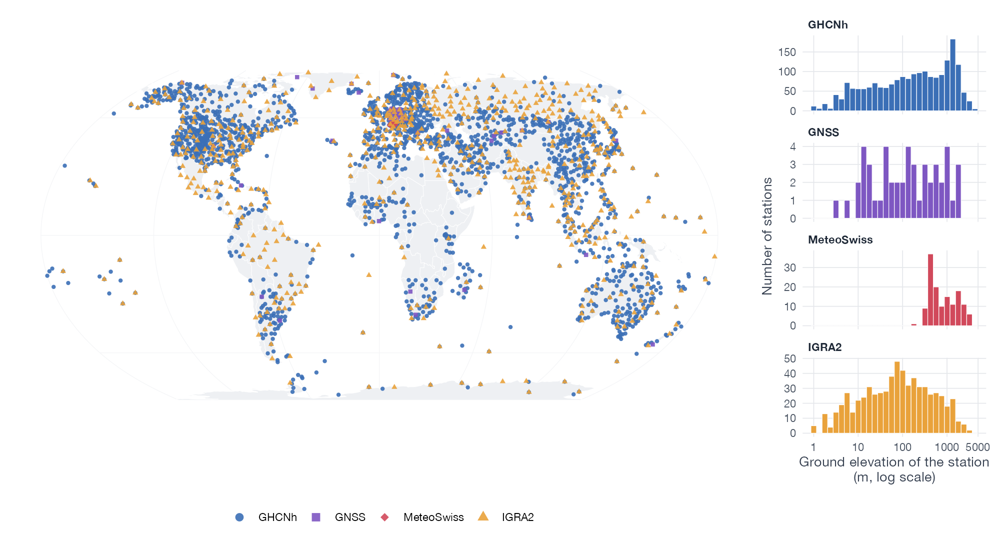

Figure 1: Reference stations used: HadISD, GNSS, MeteoSwiss and IGRA2 radiosondes.

### From raw data to reference stations

Each dataset goes through four steps (<a href="#tbl-steps" class="quarto-xref">Table 2</a>): keeping stations with enough data, thinning dense networks, removing gross errors, and checking that the height of each barometer can be trusted. The principles are the same for all datasets; only their implementation differs.

Table 2: Selection and quality control of the references: criterion and stations kept / stations before the step (share removed). Step 3 removes observations, not stations.

| step | HadISD | GNSS | MeteoSwiss | IGRA2 |
|:---|:---|:---|:---|:---|
| 1\. Enough data | pressure on ≥ 50% of days each year, ≥ 6-hourly | ≥ 180 days of data | barometer height published | ≥ 100 soundings |
|  | 6,204 / 8,381 (-26%) | 66 / 79 (-16%) | 138 / 158 (-13%) | 736 / 772 (-5%) |
| 2\. Spatial thinning | one station per 2° cell + all above 1000 m | none (small network) | none (small network) | as HadISD |
|  | 2,646 / 6,204 (-57%) |  |  | 702 / 736 (-5%) |
| 3\. Gross errors | \> 100 m and 10 robust SD from the station’s median | as HadISD | as HadISD | \> 150 m and 10 robust SD from the median of the height bin |
|  | 0.03% of observations | 0.01% of observations | 0.00% of observations | 0.04% of levels |
| 4\. Barometer height | screen: step change, gross-error rate, implausible offset | two height records agree within 1 m | published height used as given | not needed; ≥ 100 soundings with usable levels |
|  | 2,502 / 2,646 (-5%) | 47 / 66 (-29%) |  | 648 / 702 (-8%) |

**1. Enough data.** A station’s systematic error (bias) and its scatter can only be estimated reliably from a long and regular record that samples the daily and annual cycles. Stations reporting rarely or for a few weeks would add noise to every summary, so each dataset keeps only stations with a record spanning most of the study period.

**2. Spatial thinning.** HadISD and IGRA2 are dense in Europe, North America and East Asia and sparse elsewhere. Kept as they are, a few countries would dominate the global statistics, and neighbouring stations, which share the same ERA5 grid cells and weather, would count as independent evidence. We therefore keep one random station per 2°×2° cell (about 200 km), plus every station above 1000 m, because mountain stations are scarce and are where errors are expected to be largest; the cell weights described below then stop these extra mountain stations from tilting global summaries. The GNSS and MeteoSwiss networks are small and are used in full. A random 100 of the HadISD stations that also reported in 1990, 2005 and 2015 are used to test change over time.

**3. Gross errors.** Isolated values far from the rest of a station’s record, such as typing, encoding or unit errors, say nothing about ERA5 but would inflate the error statistics. They are removed with a robust rule that only catches values no atmospheric process can produce: more than 100 m and 10 robust SD from the station’s median error (for radiosondes, more than 150 m from the median of the height bin, as the error grows with height). Such values are rare (<a href="#tbl-steps" class="quarto-xref">Table 2</a>).

**4. Barometer height.** The height of the reference must be right to within a few metres. A wrong height shifts every altitude at that station by a constant, which looks exactly like a local ERA5 error, and ERA5 cannot be used to tell them apart: it gives each assimilated station a slowly varying bias correction that absorbs any persistent offset, whatever its cause (Hersbach et al. 2020). We therefore rely on documentation where it exists, and on the signatures of station errors where it does not:

- *IGRA2:* not needed. The error at each level is taken relative to the error at the surface level of the same sounding, which cancels any error in the station elevation and isolates how the error grows with height.
- *MeteoSwiss:* the published barometer height is used as given.
- *GNSS:* each station documents its barometer height twice, in its log file (antenna position plus the height of the barometer relative to it) and in each daily data file, and is kept when both agree within 1 m. GNSS heights refer to a mathematical ellipsoid and are converted to heights above sea level with the EGM96 geoid model, as used for ERA5’s orography; the more recent EGM2008 (Pavlis et al. 2012) changes the results by at most 1.8 m.
- *HadISD:* synoptic station pressure is biased at several hundred stations worldwide, often by several hPa, “mostly … \[because of\] incorrect assumptions about the station heights”, and the bias stays fairly constant in time (Vasiljevic et al. 2006; Haiden et al. 2018). Typical causes are wrong elevation metadata, GNSS elevations without geoid correction, pressure reported at a barometer height different from the listed elevation (WMO 2023) and barometer moves (ECMWF 2025), none of which HadISD’s quality control tests for (Dunn et al. 2012, 2016). Three rules screen them: a **step change** in the station’s error during 2022–2024 (32 stations; one step fitted to monthly median errors with a seasonal cycle, \|step\| ≥ 10 m and \|t\| ≥ 10), since ERA5 does not jump at one site but a station does when its barometer is moved or replaced (e.g. Wu Lu Mu Qi (77 m), Mogocha (74 m), Litang (56 m)); an **unreliable barometer**, with more than 1% of gross errors (7 stations); and an **implausible offset**, a constant error larger than 30 m plus 10% of the elevation gap between the station and ERA5’s orography (106 stations). This bound is set from references that do not depend on HadISD’s elevations. Radiosondes measure ERA5’s extrapolation error over an elevation gap at -0.7 to -1.2% of the gap (within 9% at 99% of stations), and among the 185 GNSS and MeteoSwiss stations with documented heights, only 1 exceeds the bound: Zürich/Fluntern (-50.3 m), whose pressure matches the elevation listed by HadISD (558 m) rather than the published barometer height (605 m). The stations kept form the HadISD **reference set**. Neighbouring stations, DEMs and the time series of the excluded stations support that the excluded ones are station errors, and the screen affects only the tail: the median offset and the precision hardly change without it, whereas MAE and RMSE depend on a few stations with offsets of hundreds of metres ([Appendix A.4](#sec-a-screen)). Errors of a few metres that no screen can catch remain, so the error measured on the reference set is an upper bound on ERA5’s.

### Bird flight heights

To know which heights matter, we use a rough distribution of bird flight heights: the flight segments (points between stationary periods) of 274 tagged birds in the GeoLocator master data package (<https://doi.org/10.5281/zenodo.18187092>). These heights were computed with the same pressure-to-altitude conversion assessed here, but its errors of 1–2% of height do not matter for this purpose. Tags record pressure every 5 to 60 min, so each point is weighted by the time until the next one, capped at 60 min (<a href="#fig-height" class="quarto-xref">Figure 7</a> c). Raw, 12% of the flight time comes out below the ERA5 surface. Part of it is because tags at rest read a few hPa more than ERA5’s surface pressure (tag calibration, and resting sites lower than the ERA5 grid cell), so each flight is referenced to the bird’s own ground (<a href="#sec-sensor" class="quarto-xref">Section 2.5</a>): the tag minus ERA5 pressure difference at departure and arrival, interpolated over the flight. The remaining 9% is near-ground flight or, mostly over mountains, flight along valleys below ERA5’s smoothed terrain, and is counted as flying at ground level. Half of the flight time is spent below 560 m above the ground and 90% below 2320 m.

## Analysis

### Error metrics

We compare the altitude retrieved by GeoPressureR with the reference height. At each station, the error is split into (1) its mean, the **bias**, which is constant in time and sets the **accuracy** of absolute altitude, and (2) the SD around that mean, which sets the **precision** of altitude changes. Across stations, accuracy is summarised by the median and 90th percentile of \|bias\|, and precision by the median and 90th percentile of the SD. For radiosondes, the bias and SD are computed per height bin above the ground (0–0.1, 0.1–0.25, 0.25–0.5, 0.5–1, 1–1.5, 1.5–2 km, then 1 km bins up to 6 km). Averaged over these bins, weighted by the share of bird flight time in each (<a href="#fig-height" class="quarto-xref">Figure 7</a> c), they give a **bird-weighted** in-flight bias, and a bird-weighted mean absolute error (MAE), which combines accuracy and precision.

Stations are unevenly spread, so every HadISD and radiosonde statistic gives each 2°×2° cell the same weight: a station counts one over the number of stations in its cell, shared among its observations. The extra stations kept above 1000 m therefore sharpen the results for mountains without tilting the global summaries towards them: they are 24% of the HadISD stations but carry 14% of the weight. The GNSS and MeteoSwiss networks are small and are summarised without weights.

### How the error varies

How accuracy and precision vary is studied with HadISD alone, the only reference that covers the globe. Each dimension is looked at separately, with accuracy and precision side by side:

- **Elevation gap.** The gap between the station and the ERA5 orography is the height over which GeoPressureR extrapolates ERA5’s surface pressure with its assumed temperature profile. It explains more of the differences between stations than station elevation or terrain roughness, with which it is strongly correlated, so it is the only terrain variable used. Its effect on \|bias\| and SD is fitted with a GAM (mgcv, on the log scale).
- **Geography.** What the gap leaves unexplained is mapped as the median, over 5°×5° cells, of the station bias and of the station SD divided by the SD expected from its gap.
- **Climate zone**, the main Köppen-Geiger zone.
- **Season and time of day.** The bias and SD are computed at each station for each month and each 3 h bin of local solar hour (southern hemisphere shifted by six months).
- **Change over time.** The 100 HadISD stations sampled among those that also reported in 1990, 2005 and 2015 (step 2) are evaluated in each of these years; 97 have enough data in all of them.

For each class, we show the distribution of the station bias and SD by its median and its 25–75% and 10–90% ranges. A joint GAM of all these variables, and of weather variables at the hourly level, gives the same picture ([Appendix A.1](#sec-a-offset)).

In flight, the bias is compared between climate zones and between summer and winter half-years. It is also compared with the error expected from the temperature assumption alone, $\Delta z \cdot (\bar T_\text{assumed} - \bar T_\text{obs}) / \bar T_\text{obs}$, with $\bar T_\text{obs}$ the sonde’s mean temperature of the column below the level, for levels more than 200 m above the ground.

### ERA5-Land vs ERA5 single-levels

Every evaluation is repeated with ERA5-Land, with the same metrics. On the ground, the two products are compared at the three ground references. In flight, the error is taken relative to the surface level of the same sounding, so a constant offset of the reference level cancels: comparing the two products in flight separates an error of the reference level (the orography and surface pressure of each product) from an error of the temperature profile above it.

### Formula changes

Four changes to the standard formula, which assumes dry air and a lapse rate of −6.5 K/km from the 2 m temperature, are tested on the radiosondes:

1.  **Virtual temperature.** The 2 m temperature is replaced by the 2 m virtual temperature, which accounts for the lower density of moist air. It uses the specific humidity computed from the ERA5 2 m dewpoint and surface pressure (vapour pressure from Bolton 1980), assuming that surface humidity holds through the column, as in pressure reduction to sea level (WMO 1968).
2.  **Constant fitted lapse rate.** The lapse rate $L$ is fitted by minimising the bird-weighted squared error, with the 2 m temperature and with the 2 m virtual temperature.
3.  **Lapse rate varying with season and latitude.** With the virtual temperature, $L = b_1 + b_2 a + (b_3 + b_4 a)\cos(2\pi(d - 15)/365.25)$, with $a$ the absolute latitude divided by 90° and $d$ the day of year, shifted by six months in the southern hemisphere: a mean and a seasonal cycle peaking in mid-winter, both changing linearly with latitude. The four parameters are fitted on the same objective, with $L$ kept between −9.5 K/km, close to the dry adiabatic lapse rate, and −2 K/km, which keeps it off zero and stops the latitude term from extrapolating towards the poles, where radiosondes are few. The upper bound only applies poleward of ~61° in mid-winter, for 2% of the bird-weighted flight levels, and removing it changes the MAE by 0.01 m.
4.  **GPT3 lapse rate.** With the virtual temperature, $L$ from GPT3 (<a href="#sec-virtual" class="quarto-xref">Section 2.4</a>), on its 1° and 5° grids, with nothing fitted, and with one constant added and fitted on the same objective.

The fitted lapse rates are tested with 20 random 50/50 station splits (fitting on one half, evaluating on the other). The constant lapse rate is also fitted separately per climate zone and half-year, and with an alternative objective that weights all height bins equally. Their effect on the ground is evaluated at the three ground references, with the dewpoint read from ERA5 at every station-hour and the virtual formula computed by GeoPressureR’s own `pressure_to_altitude()`.

### Reliability of the references

The stations with documented barometer heights are used for three checks of the HadISD results:

- *Accuracy and precision.* The GNSS and MeteoSwiss stations are summarised like the HadISD reference set and compared with it.
- *HadISD elevations.* At the Swiss stations present in both HadISD and MeteoSwiss, the HadISD bias is compared with the difference between the elevation listed by HadISD and the published barometer height.
- *Assimilation.* If ERA5 were drawn towards the stations it assimilates, it would fit them better than other places. We compare stations never assimilated (GNSS, and MeteoSwiss stations absent from ISD, which receives most of its data through the same exchange as ERA5) with assimilated ones (HadISD, and the other MeteoSwiss stations) within the same terrain-roughness class. We also compare the precision of HadISD stations in flat terrain by the number of other HadISD stations within 300 km, since an isolated observation weighs most in the analysis.

The effect of the barometer-height screen (step 4) is assessed by comparing the reference set with all stations, and with looser and stricter bounds ([Appendix A.4](#sec-a-screen)).

# Results

## Accuracy and precision on the ground

Table 3: Altitude error at ground level at the reference stations, 2022–2024 (m).

| reference | ERA5 | stations | Accuracy: median \|bias\| | Accuracy: p90 \|bias\| | Precision: median SD | Precision: p90 SD |
|:---|:---|---:|:---|:---|:---|:---|
| HadISD | ERA5 single-levels | 2502 | 2.5 | 11.4 | 3.6 | 7.0 |
| GNSS | ERA5 single-levels | 47 | 2.3 | 8.7 | 3.0 | 7.0 |
| MeteoSwiss | ERA5 single-levels | 138 | 2.9 | 9.7 | 5.4 | 13.5 |
| HadISD | ERA5-Land | 2160 | 9.5 | 58.3 | 5.0 | 9.6 |
| GNSS | ERA5-Land | 40 | 10.7 | 63.7 | 4.3 | 11.3 |
| MeteoSwiss | ERA5-Land | 138 | 35.2 | 121.7 | 9.0 | 17.4 |

- **On the ground, GeoPressureR’s altitude is typically within a few metres** (<a href="#tbl-main" class="quarto-xref">Table 3</a>): the median station has a constant bias of 2.5 m and a scatter (SD) of 3.6 m around it.
- **But the bias is skewed.** At 10% of the stations it exceeds 11.4 m, 4× the median, while the SD only doubles (7.0 m). A user should expect a small offset at most sites, and an offset of tens of metres at a few, mostly where ERA5’s smoothed terrain departs from the real one (next section).
- **The three references agree**, so these figures do not depend on HadISD’s metadata (see also Reliability of the references).

## How the error varies

### Elevation gap

The elevation gap is how far the station lies above or below ERA5’s smoothed terrain (the ERA5 orography of its 0.25° cell), and thus the height over which GeoPressureR has to extrapolate ERA5’s surface pressure.

- **The bias spreads with the gap, but stays centred on zero** (<a href="#fig-gap" class="quarto-xref">Figure 2</a> a). The expected \|bias\| grows from 2.3 m where ERA5’s terrain matches the station to 6.6 m for a 1000 m gap, but the gap explains only 6% of the differences in log \|bias\|: large biases occur at every gap.
- **Precision degrades steeply above a gap of ~100 m** (<a href="#fig-gap" class="quarto-xref">Figure 2</a> b). The expected SD is 3.3 m without a gap, 4.0 m for a 100 m gap and 12.1 m for a 1000 m gap. The gap explains 39% of the differences in log SD between stations.

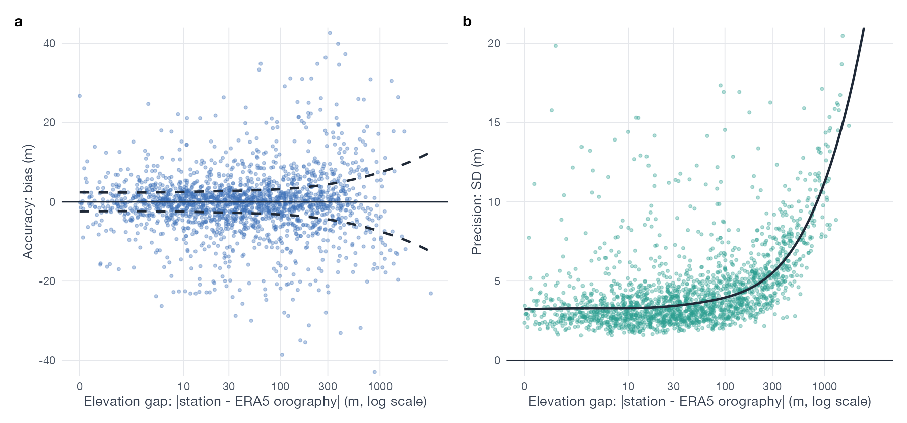

Figure 2: Bias (a) and SD (b) per station against the elevation gap, the absolute difference between station elevation and ERA5 orography (HadISD reference set). Dashed: ± the expected \|bias\|; solid: the expected SD (GAM fits).

### Climate, season and time of day

- **Polar stations have the lowest precision** (<a href="#fig-climate-ground" class="quarto-xref">Figure 3</a> c): median SD 5.0 m, against 3.4 to 4.0 m elsewhere.
- **Accuracy hardly differs between climate zones** (<a href="#fig-climate-ground" class="quarto-xref">Figure 3</a> b). Arid stations are slightly too low (median bias -1.6 m). Once the elevation gap is accounted for, precision is better than expected in Europe, Australia and on oceanic islands, and worse in Central and South Asia, the Sahel and the polar regions (<a href="#fig-map-residual" class="quarto-xref">Figure 14</a>).

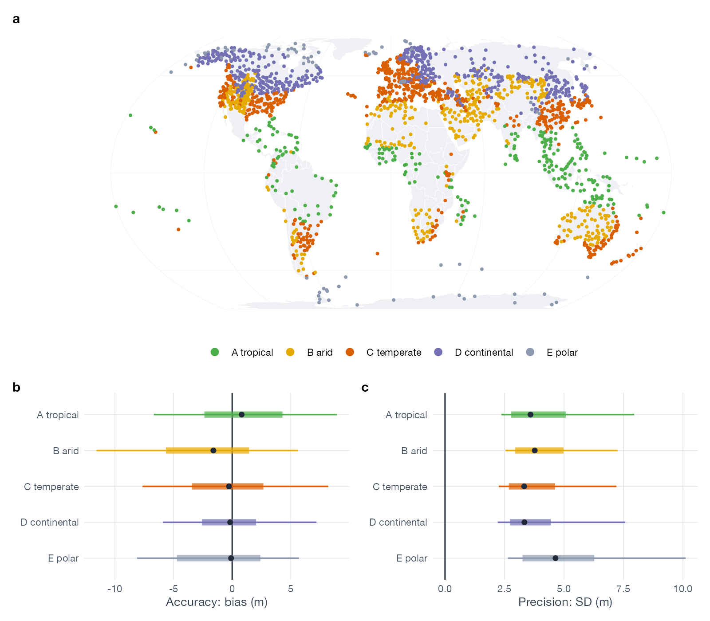

Figure 3: (a) Main Köppen-Geiger climate zone of the HadISD reference stations, and distribution of their bias (b) and SD (c) in each zone, from the lowest (top) to the highest median latitude. Point: median; thick: 25–75%; thin: 10–90% of stations.

- **The error changes little over the year** (<a href="#fig-season-hour" class="quarto-xref">Figure 4</a> a, c). The median bias shifts from 0.3 m in winter to -1.1 m in summer, and the median SD from 3.2 to 3.7 m, small against the differences between stations.
- **Nor over the day** (<a href="#fig-season-hour" class="quarto-xref">Figure 4</a> b, d). In the afternoon, the median bias is -0.9 m and the median SD 3.8 m, against 0.1 m and 3.4 m at night.

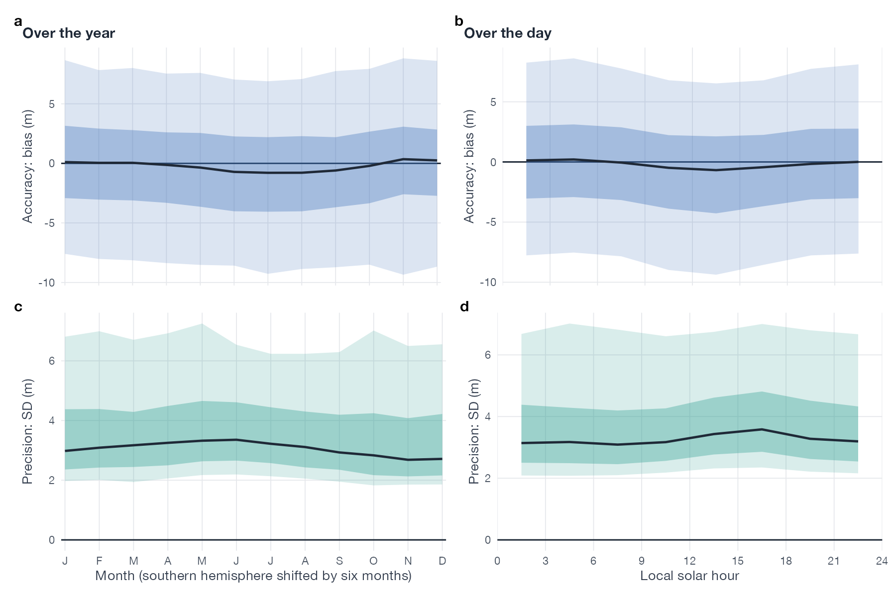

Figure 4: Distribution of the station bias (a, b) and SD (c, d) computed per month (a, c; southern hemisphere shifted by six months) and per 3 h bin of local solar hour (b, d), HadISD reference set. Line: median; bands: 25–75% and 10–90% of stations.

### Over the decades

- **ERA5 has improved, in both accuracy and precision** (<a href="#fig-era" class="quarto-xref">Figure 5</a>). For the same 97 stations, the median SD fell from 6.3 m in 1990 to 4.1 m in 2024, and the median \|bias\| from 5.9 to 4.1 m.

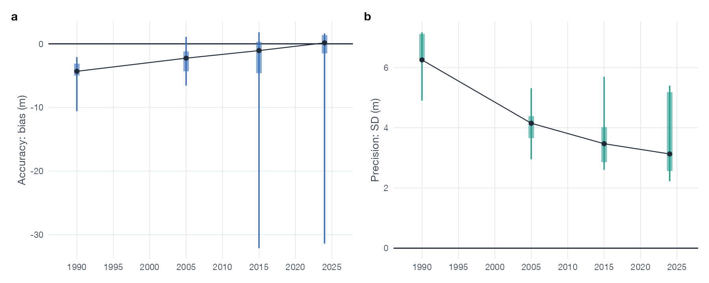

Figure 5: Distribution of the station bias (a) and SD (b) per year, for the HadISD stations reporting in every year (unweighted). Point: median; thick: 25–75%; thin: 10–90% of stations.

## ERA5-Land vs ERA5 single-levels

- **On the ground, ERA5-Land is ~4× less accurate** (<a href="#fig-land" class="quarto-xref">Figure 6</a>, <a href="#tbl-main" class="quarto-xref">Table 3</a>): median \|bias\| 9.5 m against 2.5 m at the HadISD stations, and the same holds at the GNSS and MeteoSwiss stations, so it is not an artefact of HadISD’s elevations.
- **Its precision is also lower**: median SD 5.0 m against 3.6 m.
- **In flight, the two products behave alike**: bird-weighted MAE 17.3 m with ERA5-Land against 16.4 m. Relative to the surface, the offset of the reference level cancels, so ERA5-Land’s problem is its reference level, not its temperature.

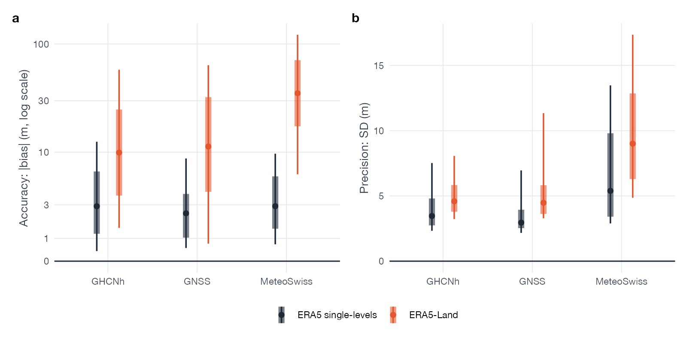

Figure 6: Station \|bias\| (a, log scale) and SD (b) with ERA5 single-levels and ERA5-Land at the three ground references. Point: median; thick: 25–75%; thin: 10–90% of stations.

## Error in flight

- **Accuracy: altitude is too low, by ~1–1.5% of the height above the ground** (<a href="#fig-height" class="quarto-xref">Figure 7</a> a): -15 m at 1–1.5 km, -35 m at 2–3 km and -91 m at 5–6 km. Most stations are biased low above 1 km.
- **Precision degrades with height as fast as accuracy** (<a href="#fig-height" class="quarto-xref">Figure 7</a> b): the median station SD reaches 14 m at 1–1.5 km and 34 m at 2–3 km, about the size of the bias.
- **Over the heights birds fly**, half of the flight time below 560 m (<a href="#fig-height" class="quarto-xref">Figure 7</a> c), the bird-weighted bias is -11.8 m and the MAE 16.4 m.
- **The temperature assumption explains it.** The error expected from the sonde’s own temperature profile explains 94% of the variance of the in-flight error (r = 0.97). The assumed layer is usually too cold (shallower real lapse rates, inversions, humidity), so the bird is placed too low.
- **Worst in continental and polar winters** (<a href="#fig-climate" class="quarto-xref">Figure 8</a>), where strong surface inversions sit under much warmer air.

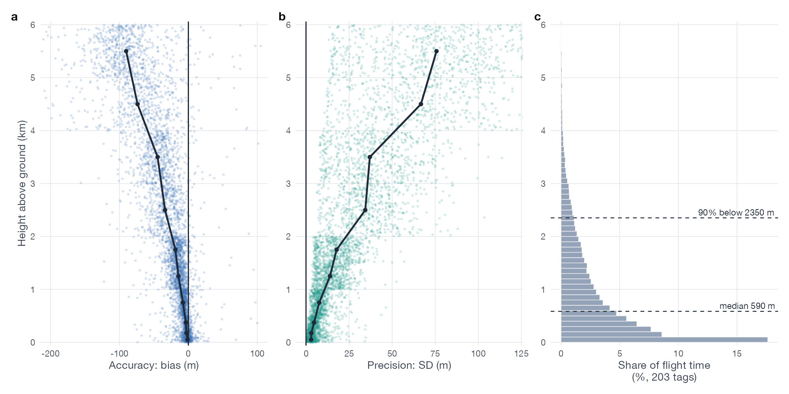

Figure 7: In-flight error against height above the ground (IGRA2, ERA5 single-levels, relative to the surface level of the same sounding). (a) Bias and (b) SD per station and height bin (points), with the cell-weighted mean bias and median SD (line). (c) Share of flight time of tracked birds by height above the ground (100 m bins; the lowest bar includes the points below the ERA5 surface); dashed: median and 90th percentile.

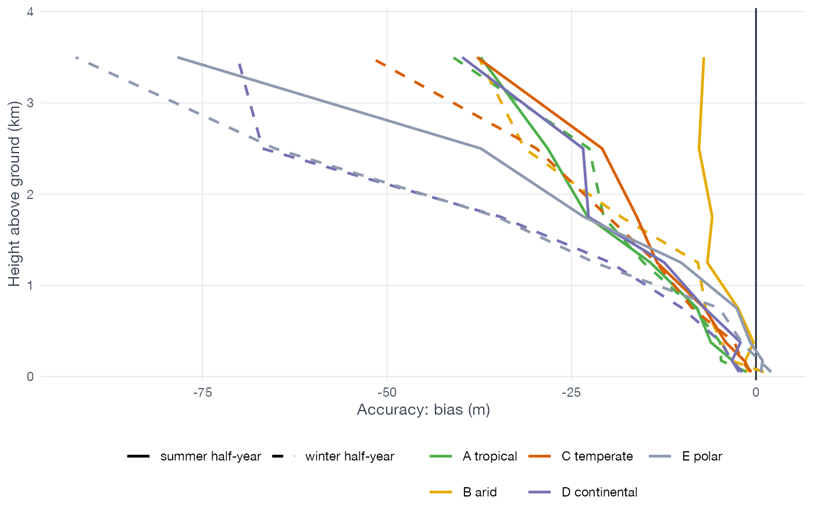

Figure 8: In-flight bias by climate zone and half-year, up to 4 km (solid: summer; dashed: winter; southern hemisphere shifted by six months).

## Formula changes

- **Constant fitted lapse rate: -4.2 K/km with the 2 m temperature, -5.1 K/km with the virtual temperature.** It is well determined: ±0.1 K/km across splits, and -5.4 K/km when all height bins weigh equally. About a third of the gap to −6.5 K/km is humidity.
- **Virtual temperature alone** reduces the held-out bias from -11.9 m to -6.8 m. The correction ranges from 0.3 K (polar winter) to 3.4 K (tropics).
- **Virtual temperature with the constant fitted lapse rate**: bias -2.3 m, MAE 16.4 → 13.5 m, better in all 20 splits. With the global value, regional and seasonal biases remain (<a href="#fig-formula-climate" class="quarto-xref">Figure 10</a>, middle): fitted per climate zone and half-year, the lapse rate ranges from -6.9 K/km (arid summer) to -2.7 K/km (polar winter).
- **A lapse rate varying with season and latitude follows these differences** (<a href="#fig-lapse-var" class="quarto-xref">Figure 9</a>). It stays near -6.6 K/km all year at the equator, while at 60° it goes from -6.2 K/km in summer to -2.1 K/km in winter, when surface inversions are frequent. On held-out stations, the bias is the same (-2.3 m), but the MAE drops to 13.0 m and the RMSE to 24.6 m, better than the constant lapse rate in every split. The remaining bias in continental and polar winters is roughly halved (<a href="#fig-formula-climate" class="quarto-xref">Figure 10</a>, right). The four parameters vary little between splits (SD below 0.4 K/km).
- **A standard lapse-rate climatology does as well, and is the GeoPressureR default.** The GPT3 lapse rate of GNSS meteorology (Landskron & Böhm 2018), interpolated on its 1° grid at the date and place and used with the virtual temperature, fits nothing to our data, yet gives a held-out MAE of 13.1 m (13.3 m on its 5° grid), against 13.0 m for our fit. Our fit is slightly better below 1 km, where most of the bird-weighted error is; GPT3 is better above, with an RMSE of 19.6 against 20.8 m at 1–1.5 km and 42.9 against 45.2 m at 2–3 km, because it also varies with longitude, e.g. between continental and maritime winters. Adding a fitted constant to it changes the MAE by only 0.1 m, so its level needs no correction.
- **Little change on the ground** (<a href="#tbl-formula-ground" class="quarto-xref">Table 4</a>). The virtual formula also changes the extrapolation over the elevation gap, by about 3.9 m per km of gap. It moves the median station bias by -0.06 m, and by less than 1.1 m at 90% of the HadISD stations. At the stations more than 500 m from ERA5’s orography, the median \|bias\| improves (6.6 → 5.4 m) but its 90th percentile worsens (18.7 → 21.9 m): shallow or positive winter lapse rates extrapolate poorly into valleys and onto ridges. Our season-latitude fit does worse there (p90 25.9 m).
- **Precision does not change** (<a href="#fig-formula" class="quarto-xref">Figure 11</a> b). The corrections remove the bias up to ~3 km, but the SD stays the same: no lapse rate set from the date and place can follow the day-to-day temperature profile.

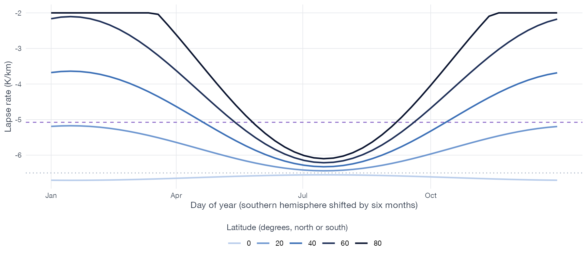

Figure 9: Lapse rate varying with season and latitude, fitted on all radiosonde stations (with the virtual temperature; capped at −2 K/km). Dashed: constant fitted lapse rate; dotted: −6.5 K/km.

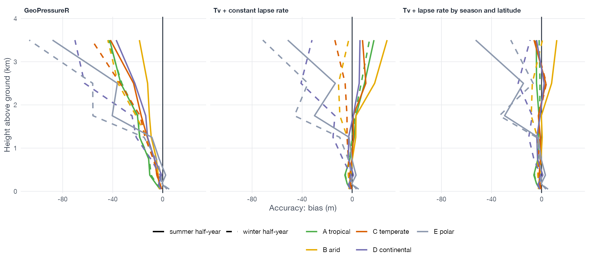

Figure 10: In-flight bias by climate zone and half-year: standard formula (left), virtual temperature with the constant fitted lapse rate (middle) and with the lapse rate varying with season and latitude (right), up to 4 km. Solid: summer; dashed: winter.

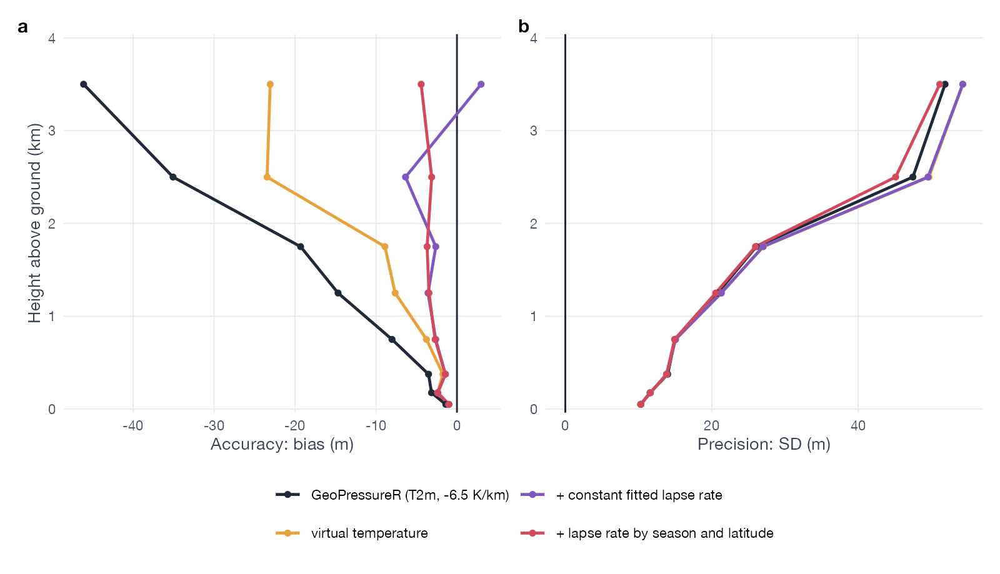

Figure 11: Bias (a) and SD (b) against height, up to 4 km, for the standard formula and the formula changes (lapse rates fitted on all stations).

Table 4: Ground-level error with the standard and the virtual formula (GPT3 lapse rate), and with the virtual temperature and our lapse rate varying with season and latitude, ERA5 single-levels (m).

| reference | formula | stations | Accuracy: median \|bias\| | Accuracy: p90 \|bias\| | Precision: median SD | Precision: p90 SD | MAE |
|:---|:---|---:|:---|:---|:---|:---|:---|
| HadISD | standard | 2502 | 2.5 | 11.4 | 3.6 | 7.0 | 6.1 |
| HadISD | virtual T + season-latitude fit | 2502 | 2.6 | 11.1 | 3.7 | 7.2 | 6.1 |
| HadISD | virtual, GPT3 (default) | 2502 | 2.6 | 11.0 | 3.7 | 7.2 | 6.1 |
| GNSS | standard | 47 | 2.3 | 8.7 | 3.0 | 7.0 | 5.4 |
| GNSS | virtual T + season-latitude fit | 47 | 2.4 | 7.3 | 2.9 | 7.5 | 5.3 |
| GNSS | virtual, GPT3 (default) | 47 | 2.4 | 7.3 | 2.9 | 7.5 | 5.3 |
| MeteoSwiss | standard | 138 | 2.9 | 9.7 | 5.4 | 13.5 | 6.9 |
| MeteoSwiss | virtual T + season-latitude fit | 138 | 2.6 | 7.7 | 5.7 | 14.6 | 7.0 |
| MeteoSwiss | virtual, GPT3 (default) | 138 | 2.6 | 7.6 | 5.8 | 15.0 | 7.0 |
| HadISD, gap \> 500 m | standard | 154 | 6.6 | 18.7 | 10.1 | 15.6 | 13.6 |
| HadISD, gap \> 500 m | virtual T + season-latitude fit | 154 | 5.9 | 25.9 | 10.3 | 16.5 | 14.0 |
| HadISD, gap \> 500 m | virtual, GPT3 (default) | 154 | 5.4 | 21.9 | 10.5 | 16.5 | 13.6 |

## Reliability of the references

Table 5: Ground-level error with different references and selections, ERA5 single-levels (m). HadISD: before (all stations) and after the barometer-height screen. GNSS height-checked: the two height records of the station agree within 1 m. MeteoSwiss not in ISD: probably not assimilated by ERA5.

|  | stations | Accuracy: median \|bias\| | Accuracy: p90 \|bias\| | Precision: median SD | Precision: p90 SD |
|:---|---:|:---|:---|:---|:---|
| HadISD, all stations | 2646 | 2.8 | 15.9 | 3.7 | 7.4 |
| HadISD, reference set | 2502 | 2.5 | 11.4 | 3.6 | 7.0 |
| GNSS, all | 66 | 2.8 | 14.5 | 3.2 | 6.3 |
| GNSS, height-checked | 47 | 2.3 | 8.7 | 3.0 | 7.0 |
| GNSS, height-checked, barometer | 30 | 1.9 | 4.6 | 2.6 | 4.8 |
| GNSS, height-checked, weather transmitter | 14 | 1.7 | 9.4 | 3.7 | 7.0 |
| MeteoSwiss, all | 138 | 2.9 | 9.7 | 5.4 | 13.5 |
| MeteoSwiss, not in ISD | 9 | 4.4 | 14.5 | 7.2 | 14.6 |

- **Checking the barometer height matters for the tail, not for the typical error** (<a href="#tbl-indep" class="quarto-xref">Table 5</a>). Without the screen, HadISD’s median \|bias\| barely changes, but its 90th percentile rises from 11.4 to 15.9 m, driven by a few stations with offsets of hundreds of metres ([Appendix A.4](#sec-a-screen)). Likewise, the GNSS stations whose two height records disagree widen the 90th percentile from 8.7 to 14.5 m.
- **HadISD elevations explain much of its station-to-station spread** ([Appendix A.2](#sec-a-elevation)). At the 32 Swiss stations present in both datasets, the HadISD bias follows the difference between the elevation listed by HadISD and the published barometer height almost one for one (r = 0.93): the median \|bias\| drops from 7.2 m with HadISD’s elevations to 3.8 m with the barometer heights, and 12 of the 31 stations that pass our screen have an elevation more than 5 m off.
- **No sign that assimilation flatters ERA5.** In flat terrain, the GNSS stations, never assimilated, have a median \|bias\| of 2.5 m and SD of 2.5 m, comparable to the 1.9 m and 3.1 m of HadISD, and isolated HadISD stations do not have better precision than those in dense networks ([Appendix A.5](#sec-a-assim)).

# Discussion

## What error to expect

Table 6: Expected error of the altitude from GeoPressureR with ERA5 single-levels, for a perfect pressure reading. Ground: median and 90th percentile of the station \|bias\|, pooled MAE and median SD, HadISD reference set by terrain roughness. Flight: error of the height above the ground, all radiosonde stations; held-out: bird-weighted, 20 station splits. An absolute flight altitude adds the ground error to the flight error.

| Quantity | Standard formula | Virtual formula (default) | Add for the sensor (<a href="#sec-sensor" class="quarto-xref">Section 2.5</a>) |
|----|----|----|----|
| Absolute altitude on the ground, flat terrain | \|bias\| 1.9 m (p90 8.3 m), MAE 4.6 m | within 1 m of standard at most stations | absolute accuracy, ~8 m per hPa |
| Absolute altitude on the ground, mountains | \|bias\| 5.9 m (p90 24.1 m), MAE 13.4 m | median a little better, tail a little worse | as above |
| Altitude *changes* at one site | SD 3.1 m (flat) to 8.2 m (mountains) | unchanged | relative accuracy, ≲1 m |
| Height above the ground in flight, 1–1.5 km | bias -14.7 m, RMSE 25.5 m | bias -3.8 m, RMSE 19.6 m | drift and relative accuracy |
| Height above the ground in flight, 2–3 km | bias -35.1 m, RMSE 59.0 m | bias -4.7 m, RMSE 42.9 m | as above |
| Height above the ground, over the heights birds fly (held-out) | bias -11.9 m, MAE 16.4 m | bias -3.2 m, MAE 13.1 m | as above |

**On the ground, the error is a fixed offset per place, not noise.** Station identity explains almost all the explainable variation of the error, while hour of day, season and weather hardly matter ([Appendix A.1](#sec-a-offset)). The offset comes from the terrain the 0.25° grid cannot resolve, so it roughly triples from flat terrain to mountains. Altitude changes at one site are therefore more reliable than absolute altitudes, and comparing absolute altitudes between distant sites, or with a fine-scale DEM, should allow for tens of metres in mountains. These figures do not depend on HadISD’s metadata or on our screen: the stations with documented barometer heights give the same accuracy and precision (<a href="#tbl-indep" class="quarto-xref">Table 5</a>). If anything, HadISD is pessimistic: in Switzerland, about half of its apparent error comes from listed elevations that are not the barometer height ([Appendix A.2](#sec-a-elevation)).

**In flight, the error grows with height.** With the standard formula, it is mostly a bias from the temperature assumed for the column, which explains 94% of its variance ([Appendix A.3](#sec-a-temperature)). Because the column is usually assumed too cold, flight heights are conservative: a bird 2 km above the ground is placed about 25–35 m too low, twice as much in continental and polar winters, when strong surface inversions sit under warmer air, and two to four times more at night than by day ([Appendix B](#sec-b)). The virtual formula removes most of this bias up to ~3 km, but not the scatter, which follows the day-to-day temperature profile.

**The sensor matters most for absolute altitude.** An absolute accuracy of ±1 hPa adds ±8 m, more than the median ground offset of the conversion in flat terrain. Ground elevations from a geolocator should be read with the accuracy of its sensor in mind, and calibrated where the bird’s elevation is known, e.g. at the equipment site. Altitude changes, and flight heights referenced to the bird’s own ground, are much less affected (<a href="#sec-sensor" class="quarto-xref">Section 2.5</a>).

**Older tracks are somewhat less accurate.** The ground-level bias in 1990 was about 1.5 times that of 2024, likely because fewer observations constrained ERA5 then (<a href="#fig-era" class="quarto-xref">Figure 5</a>).

## Comparison with other studies

**ERA5 surface pressure.** Our pooled ground RMSE (9.6 m ≈ 1.2 hPa) is close to the ~1 hPa RMSE reported for ERA5 surface pressure over China (Huang et al. 2023). Both pool the constant offset of each station and the scatter around it, which our median \|bias\| (2.5 m) and SD (3.6 m) separate. As in our screen, validations against GNSS meteorological sensors had to remove about a quarter of the stations for offsets or noise (Wang et al. 2017).

**Field studies of birds.** On grounded raptors, Schaub et al. (2023) found ERA5-referenced barometric heights 5–15 m below the terrain, more than our ground offsets, as expected once the tag’s own offset and errors of the terrain model are added, which our references exclude. At heights of a few tens of metres, Lato et al. (2022) found barometric heights 1–2 m too low against a laser altimeter, consistent with the bias of m we find below 100 m. Comparisons between barometric and GPS heights in flight (Schaub et al. 2023; Johnston et al. 2023) do not identify which one is right, and used other formulas and calibrations, so they cannot test the height-dependent bias we find.

**Other fields.** The varying lapse rate is the same idea as the gridded, seasonal lapse rates that GNSS meteorology uses to bring pressure to a station’s height (Böhm et al. 2015; Landskron & Böhm 2018). In aviation, barometric altitude corrected with ERA5 pressure-level temperatures matches precise GNSS within a few metres (Simonetti & García Crespillo 2024), which shows what a full temperature profile can achieve.

## Does assimilation flatter the error?

ERA5 assimilates the pressure of most of our ground references, so it could fit them better than the places birds visit. Two properties of the analysis limit this. A single surface pressure observation contributes about 20% of the analysis at its own location in dense networks (Cardinali et al. 2004), and its increment is spread over hundreds of kilometres (Bell et al. 2021), so assimilation cannot create the sub-grid structure that dominates the ground error. Persistent offsets are absorbed by a bias correction specific to each station (Hersbach et al. 2020), so ERA5 is not pulled towards a station’s constant error either. We found no sign of a large advantage for assimilated stations: GNSS stations, never assimilated, fit as well as HadISD stations in the same terrain, and isolated HadISD stations, where an observation weighs most, do not fit better than stations in dense networks ([Appendix A.5](#sec-a-assim)). The figures should therefore hold away from the stations, except where stations are sparse (parts of Africa, South America and Siberia), where ERA5 itself is less constrained and the error is probably larger.

## ERA5 single-levels or ERA5-Land?

**Use ERA5 single-levels for altitude.** ERA5-Land adjusts the surface pressure of ERA5 to its own finer orography (Muñoz-Sabater et al. 2021), but not consistently with the orography it publishes, which shifts every altitude by a fixed offset that depends on the place ([GeoPressureAPI#27](https://github.com/GeoPressure/GeoPressureAPI/issues/27)). In flight, where this offset cancels, both products agree, which confirms that the problem lies in the reference level and not in ERA5-Land’s weather.

## The choice of formula

**Virtual temperature.** It corrects a simplification of the physics, has no free parameter, removes about 40% of the in-flight bias on its own, and only requires the ERA5 2 m dewpoint.

**A standard lapse-rate climatology rather than our own fit.** A constant lapse rate fitted to the radiosondes (-5.1 K/km with the virtual temperature) removes most of the remaining bias, but leaves the winter tracks of mid- and high-latitude birds too low. Our four-parameter lapse rate varying with season and latitude fixes most of this (MAE 13.0 m on held-out stations), and so does GPT3 (13.1 m), which also follows longitude and does better above 1 km and over large elevation gaps on the ground. We chose GPT3 for GeoPressureR because it is an established model, derived independently of our references, so its accuracy here is not tuned to them; it costs a 1° lookup table, downloaded once, and no extra ERA5 variable. It is the default from GeoPressureR v3.7.0 (`altitude_formula = "virtual"`); `altitude_formula = "standard"` reproduces earlier versions. GeoPressureAPI still computes `"virtual"` with our season-latitude fit until it adopts GPT3.

**Only the actual temperature profile can reduce the scatter.** That needs ERA5 on pressure levels at every point of the track, which the ARCO single-levels archive does not provide, and far more data than the three surface variables used now.

## Limitations

- **The sensor is not evaluated** (<a href="#sec-sensor" class="quarto-xref">Section 2.5</a>): these are errors of the conversion, given a perfect pressure reading.
- **Radiosondes.** The ERA5 column at the launch site is used, and balloon drift (a few km below 5 km) is ignored. Sonde heights are mostly computed from the sonde’s own pressure, temperature and humidity with the hypsometric equation, so the in-flight error measures the error of the column temperature assumed by the formula relative to the sonde’s, and the share it explains is partly so by construction. The ~10 m scatter in the first 100 m partly reflects integer-metre reporting.
- **Reference heights.** HadISD elevations are not always those of the barometer, and the screen cannot catch errors of a few metres; the stations with documented heights are few and unevenly spread (about half the GNSS stations are in Germany).
- **Sampling.** Thinning and cell weights even out station density only where stations exist: parts of Africa, South America and Siberia remain sparsely covered, and all references are on land.

# Data and code availability

- **Code, derived tables and figures:** <https://github.com/GeoPressure/altitude-validation> (code MIT; tables, figures and this report CC BY 4.0). Every step can be rerun with `Rscript run_all.R`. Code and the downloaded data needed to rerun it (all but HadISD) are archived on Zenodo, <https://doi.org/10.5281/zenodo.23085093>.
- **GeoPressureR** 3.6.3.9000: <https://github.com/GeoPressure/GeoPressureR>, documentation <https://raphaelnussbaumer.com/GeoPressureR/>. **GeoPressureAPI:** <https://github.com/GeoPressure/GeoPressureAPI>.
- **ERA5 single-levels** (<https://doi.org/10.24381/cds.adbb2d47>) **and ERA5-Land** (<https://doi.org/10.24381/cds.e2161bac>): Copernicus Climate Change Service, read from the ECMWF ARCO archive (<https://github.com/google-research/arco-era5>), as GeoPressureR does.
- **HadISD v3.4.3.2025f:** Met Office Hadley Centre, <https://www.metoffice.gov.uk/hadobs/hadisd/>, Non-Commercial Government Licence. It may contain data governed by WMO Resolution 40 Annex 1; only derived statistics are published here.
- **IGRA v2.2:** NOAA NCEI, <https://doi.org/10.7289/V5X63K0Q>.
- **GNSS meteorological data:** International GNSS Service (IGS) and EUREF Permanent GNSS Network, daily RINEX met files from the BKG GNSS Data Center (<https://igs.bkg.bund.de>); site logs from IGS (<https://files.igs.org/pub/station/log/>) and EPN (<https://epncb.oma.be/ftp/station/log/>).
- **MeteoSwiss:** SwissMetNet open data (<https://data.geo.admin.ch/ch.meteoschweiz.ogd-smn>), “Source: MeteoSwiss”. Assimilation status from the ISD station history (<https://www.ncei.noaa.gov/pub/data/noaa/isd-history.csv>).
- **Geoid models:** EGM96 and EGM2008, NGA (grids distributed with PROJ, <https://cdn.proj.org>).
- **Bird heights:** GeoLocator master data package (<https://doi.org/10.5281/zenodo.18187092>).
- **DEMs:** Mapzen terrain tiles (<https://registry.opendata.aws/terrain-tiles/>), SRTM GL1 (<https://doi.org/10.5067/MEaSUREs/SRTM/SRTMGL1.003>) and ASTER GDEM v3 (<https://doi.org/10.5067/ASTER/ASTGTM.003>), via OpenTopoData (<https://www.opentopodata.org>).
- **Climate zones:** Köppen-Geiger, 1986–2010, from the kgc R package (<https://cran.r-project.org/package=kgc>). **Basemaps:** Natural Earth (<https://www.naturalearthdata.com>).

# References

- Bäckman J, Andersson A, Alerstam T, Pedersen L, Sjöberg S, Thorup K, Tøttrup AP (2017) Activity and migratory flights of individual free-flying songbirds throughout the annual cycle: method and first case study. *Journal of Avian Biology* 48:309–319. <https://doi.org/10.1111/jav.01068>
- Bell B, Hersbach H, Simmons A, et al. (2021) The ERA5 global reanalysis: preliminary extension to 1950. *Quarterly Journal of the Royal Meteorological Society* 147:4186–4227. <https://doi.org/10.1002/qj.4174>
- Böhm J, Möller G, Schindelegger M, Pain G, Weber R (2015) Development of an improved empirical model for slant delays in the troposphere (GPT2w). *GPS Solutions* 19:433–441. <https://doi.org/10.1007/s10291-014-0403-7>
- Bolton D (1980) The computation of equivalent potential temperature. *Monthly Weather Review* 108:1046–1053. <https://doi.org/10.1175/1520-0493(1980)108%3C1046:TCOEPT%3E2.0.CO;2>
- Cardinali C, Pezzulli S, Andersson E (2004) Influence-matrix diagnostic of a data assimilation system. *Quarterly Journal of the Royal Meteorological Society* 130:2767–2786. <https://doi.org/10.1256/qj.03.205>
- Cleasby IR, Wakefield ED, Bearhop S, Bodey TW, Votier SC, Hamer KC (2015) Three-dimensional tracking of a wide-ranging marine predator: flight heights and vulnerability to offshore wind farms. *Journal of Applied Ecology* 52:1474–1482. <https://doi.org/10.1111/1365-2664.12529>
- Doniol-Valcroze P, Beggs I, Bell F, et al. (2026) Multi-sensor logger tracking reveals the threats of offshore windfarms to passerine-sized birds. *Conservation Letters* 19:e70077. <https://doi.org/10.1111/con4.70077>
- Dufour P, Nussbaumer R, Briedis M, et al. (2026) Ecological barrier crossing strategies in small migratory birds depend on wing morphology and plumage color. *iScience* 29:114466. <https://doi.org/10.1016/j.isci.2025.114466>
- Dunn RJH, Willett KM, Parker DE, Mitchell L (2016) Expanding HadISD: quality-controlled, sub-daily station data from 1931. *Geoscientific Instrumentation, Methods and Data Systems* 5:473–491.
- Dunn RJH, Willett KM, Thorne PW, et al. (2012) HadISD: a quality-controlled global synoptic report database for selected variables at long-term stations from 1973–2011. *Climate of the Past* 8:1649–1679. <https://doi.org/10.5194/cp-8-1649-2012>
- Durre I, Vose RS, Wuertz DB (2006) Overview of the Integrated Global Radiosonde Archive. *Journal of Climate* 19:53–68. <https://doi.org/10.1175/JCLI3594.1>
- Durre I, Yin X, Vose RS, et al. (2018) Enhancing the data coverage in the Integrated Global Radiosonde Archive. *Journal of Atmospheric and Oceanic Technology* 35:1753–1770.
- ECMWF (2025) Guidance on SYNOP surface pressure monitoring issues. ECMWF Confluence (E. Kuscu).
- Haiden T, Dahoui M, Ingleby B, et al. (2018) Use of in situ surface observations at ECMWF. ECMWF Technical Memorandum 834. <https://www.ecmwf.int/sites/default/files/elibrary/2018/80920-use-situ-surface-observations-ecmwf.pdf>
- Hersbach H, Bell B, Berrisford P, et al. (2020) The ERA5 global reanalysis. *Quarterly Journal of the Royal Meteorological Society* 146:1999–2049. <https://doi.org/10.1002/qj.3803>
- Huang L, Fang X, Zhang T, et al. (2023) Evaluation of surface temperature and pressure derived from MERRA-2 and ERA5 reanalysis datasets and their applications in hourly GNSS precipitable water vapor retrieval over China. *Geodesy and Geodynamics* 14:111–120. <https://doi.org/10.1016/j.geog.2022.08.006>
- ICAO (1993) *Manual of the ICAO Standard Atmosphere*, Doc 7488/3, 3rd ed. International Civil Aviation Organization, Montreal.
- ICAO (2018) *Procedures for Air Navigation Services – Aircraft Operations (PANS-OPS)*, Doc 8168, Volume I. International Civil Aviation Organization, Montreal.
- ISO (1975) *ISO 2533:1975 Standard Atmosphere*. International Organization for Standardization.
- Johnston DT, Thaxter CB, Boersch-Supan PH, et al. (2023) Flight heights obtained from GPS versus altimeters influence estimates of collision risk with offshore wind turbines in Lesser Black-backed Gulls *Larus fuscus*. *Movement Ecology* 11:66. <https://doi.org/10.1186/s40462-023-00431-z>
- Landskron D, Böhm J (2018) VMF3/GPT3: refined discrete and empirical troposphere mapping functions. *Journal of Geodesy* 92:349–360. <https://doi.org/10.1007/s00190-017-1066-2>
- Lato KA, Stepanuk JEF, Heywood EI, Conners MG, Thorne LH (2022) Assessing the accuracy of altitude estimates in avian biologging devices. *PLOS ONE* 17:e0276098. <https://doi.org/10.1371/journal.pone.0276098>
- Liechti F, Bauer S, Dhanjal-Adams KL, Emmenegger T, Zehtindjiev P, Hahn S (2018) Miniaturized multi-sensor loggers provide new insight into year-round flight behaviour of small trans-Sahara avian migrants. *Movement Ecology* 6:19. <https://doi.org/10.1186/s40462-018-0137-1>
- Minder JR, Mote PW, Lundquist JD (2010) Surface temperature lapse rates over complex terrain: lessons from the Cascade Mountains. *Journal of Geophysical Research* 115:D14122.
- Muñoz-Sabater J, Dutra E, Agustí-Panareda A, et al. (2021) ERA5-Land: a state-of-the-art global reanalysis dataset for land applications. *Earth System Science Data* 13:4349–4383.
- NASA JPL (2013) NASA Shuttle Radar Topography Mission Global 1 arc second. NASA EOSDIS Land Processes DAAC. <https://doi.org/10.5067/MEaSUREs/SRTM/SRTMGL1.003>
- NASA/METI/AIST/Japan Spacesystems and U.S./Japan ASTER Science Team (2019) ASTER Global Digital Elevation Model V003. NASA EOSDIS Land Processes DAAC. <https://doi.org/10.5067/ASTER/ASTGTM.003>
- Nussbaumer R, Gravey M, Briedis M, Liechti F (2023a) Global positioning with animal-borne pressure sensors. *Methods in Ecology and Evolution* 14:1104–1117. <https://doi.org/10.1111/2041-210X.14043>
- Nussbaumer R, Gravey M, Briedis M, Liechti F, Sheldon D (2023b) Reconstructing bird trajectories from pressure and wind data using a highly optimized hidden Markov model. *Methods in Ecology and Evolution* 14:1118–1129. <https://doi.org/10.1111/2041-210X.14082>
- Pavlis NK, Holmes SA, Kenyon SC, Factor JK (2012) The development and evaluation of the Earth Gravitational Model 2008 (EGM2008). *Journal of Geophysical Research: Solid Earth* 117:B04406. <https://doi.org/10.1029/2011JB008916>
- Péron G, Calabrese JM, Duriez O, et al. (2020) The challenges of estimating the distribution of flight heights from telemetry or altimetry data. *Animal Biotelemetry* 8:5. <https://doi.org/10.1186/s40317-020-00194-z>
- Poessel SA, Duerr AE, Hall JC, Braham MA, Katzner TE (2018) Improving estimation of flight altitude in wildlife telemetry studies. *Journal of Applied Ecology* 55:2064–2070. <https://doi.org/10.1111/1365-2664.13135>
- Rhyne GS, Stouffer PC, Briedis M, Nussbaumer R (2024) Barometric geolocators can reveal unprecedented details about the migratory ecology of small birds. *Ornithology* 141:ukae010. <https://doi.org/10.1093/ornithology/ukae010>
- Rime Y, Nussbaumer R, Briedis M, et al. (2023) Multi-sensor geolocators unveil global and local movements in an Alpine-breeding long-distance migrant. *Movement Ecology* 11:19. <https://doi.org/10.1186/s40462-023-00381-6>
- Rodríguez E, Morris CS, Belz JE (2006) A global assessment of the SRTM performance. *Photogrammetric Engineering & Remote Sensing* 72:249–260. <https://doi.org/10.14358/PERS.72.3.249>
- Rolland C (2003) Spatial and seasonal variations of air temperature lapse rates in Alpine regions. *Journal of Climate* 16:1032–1046.
- Schaub T, Millon A, De Zutter C, et al. (2023) How to improve the accuracy of height data from bird tracking devices? An assessment of high-frequency GPS tracking and barometric altimetry in field conditions. *Animal Biotelemetry* 11:31. <https://doi.org/10.1186/s40317-023-00342-1>
- Simonetti M, García Crespillo O (2024) Geodetic altitude from barometer and weather data for GNSS integrity monitoring in aviation. *NAVIGATION* 71:navi.637. <https://doi.org/10.33012/navi.637>
- Sjöberg S, Malmiga G, Nord A, et al. (2021) Extreme altitudes during diurnal flights in a nocturnal songbird migrant. *Science* 372:646–648. <https://doi.org/10.1126/science.abe7291>
- Sjöberg S, Pedersen L, Malmiga G, et al. (2018) Barometer logging reveals new dimensions of individual songbird migration. *Journal of Avian Biology* 49:e01821. <https://doi.org/10.1111/jav.01821>
- Smith A, Lott N, Vose R (2011) The Integrated Surface Database: recent developments and partnerships. *Bulletin of the American Meteorological Society* 92:704–708.
- Soci C, Hersbach H, Simmons A, et al. (2024) The ERA5 global reanalysis from 1940 to 2022. *Quarterly Journal of the Royal Meteorological Society* 150:4014–4048. <https://doi.org/10.1002/qj.4803>
- Stone PH, Carlson JH (1979) Atmospheric lapse rate regimes and their parameterization. *Journal of the Atmospheric Sciences* 36:415–423.
- Vasiljevic D, Andersson E, Isaksen L, Garcia-Mendez A (2006) Surface pressure bias correction in data assimilation. *ECMWF Newsletter* 108:20–27. <https://doi.org/10.21957/uv295rfmx5>
- Wallace JM, Hobbs PV (2006) *Atmospheric Science: An Introductory Survey*, 2nd ed., ch. 3. Academic Press. <https://doi.org/10.1016/B978-0-12-732951-2.50008-9>
- Wang X, Zhang K, Wu S, et al. (2017) Determination of zenith hydrostatic delay and its impact on GNSS-derived integrated water vapor. *Atmospheric Measurement Techniques* 10:2807–2820. <https://doi.org/10.5194/amt-10-2807-2017>
- WMO (1968) *Methods in Use for the Reduction of Atmospheric Pressure*. Technical Note 91, WMO-No. 226. World Meteorological Organization, Geneva.
- WMO (2023) *Guide to Instruments and Methods of Observation*, Volume I (WMO-No. 8), chapters 1 (station elevation) and 3 (atmospheric pressure). World Meteorological Organization, Geneva.

# Appendix A: evidence for the Discussion

Each section supports one claim of the Discussion (sections 4.1 and 4.2).

## A.1 On the ground, the error is a fixed offset per place

Hour by hour, the de-biased error depends on the station and hardly on time or weather. A GAM of its absolute value explains 32% of its deviance; dropping the station (a random effect) loses 29%, while local solar hour, season, boundary layer height, skin minus 2 m temperature and pressure tendency each lose less than 0.5% (<a href="#tbl-gam" class="quarto-xref">Table 7</a>). Across stations, the elevation gap is the main control of precision, and no variable explains much of the bias.

Table 7: Joint GAMs of the ground-level error, HadISD reference set: deviance explained by the full model, and lost when each term is dropped. Station level: log \|bias\| and log SD of each station. Hourly level: absolute de-biased error, with the station as a random effect.

| response | term | full model | lost when dropped | n |
|:---|:---|---:|---:|:---|
| log \|bias\| | station elevation - ERA5 orography | 0.143 | 0.0126 | 2,423 |
| log \|bias\| | sub-grid terrain roughness | 0.143 | 0.0173 | 2,423 |
| log \|bias\| | absolute latitude | 0.143 | 0.0136 | 2,423 |
| log \|bias\| | Koppen climate zone | 0.143 | 0.0100 | 2,423 |
| log SD | station elevation - ERA5 orography | 0.546 | 0.1077 | 2,423 |
| log SD | sub-grid terrain roughness | 0.546 | 0.0169 | 2,423 |
| log SD | absolute latitude | 0.546 | 0.0063 | 2,423 |
| log SD | Koppen climate zone | 0.546 | 0.0314 | 2,423 |
| \|de-biased error\| (observations) | local solar hour | 0.323 | 0.0005 | 2,000,000 |
| \|de-biased error\| (observations) | season | 0.323 | 0.0012 | 2,000,000 |
| \|de-biased error\| (observations) | boundary layer height | 0.323 | 0.0051 | 2,000,000 |
| \|de-biased error\| (observations) | skin - 2 m temperature | 0.323 | 0.0002 | 2,000,000 |
| \|de-biased error\| (observations) | 6 h pressure tendency | 0.323 | 0.0014 | 2,000,000 |
| \|de-biased error\| (observations) | station (random effect) | 0.323 | 0.2866 | 2,000,000 |

## A.2 HadISD’s listed elevations inflate its errors

At the 32 Swiss stations present in both HadISD and MeteoSwiss, the HadISD bias follows the difference between the elevation listed by HadISD and the published barometer height almost one for one (r = 0.93; <a href="#fig-swiss" class="quarto-xref">Figure 12</a>). With the barometer heights, the same ERA5 altitudes have a median \|bias\| of 3.8 m instead of 7.2 m. 12 of the 31 stations that pass our screen have an elevation more than 5 m off, too little for any screen to catch.

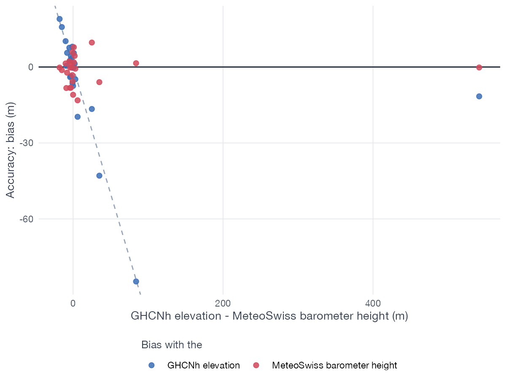

Figure 12: Bias at the Swiss stations present in both HadISD and MeteoSwiss, computed with the HadISD elevation (blue) and with the MeteoSwiss barometer height (red), against the difference between the two heights. Dashed: bias = −difference, the bias expected if the whole error came from the listed elevation.

## A.3 The temperature assumption explains the in-flight error

For every sonde level more than 200 m above the ground, the error expected from the difference between the assumed and the observed mean temperature of the column, $\Delta z \cdot (\bar T_\text{assumed} - \bar T_\text{obs}) / \bar T_\text{obs}$, matches the observed error (<a href="#fig-temperature" class="quarto-xref">Figure 13</a>): it explains 94% of its variance (r = 0.97). The in-flight error is therefore almost entirely an error of the assumed temperature profile, not of ERA5’s pressure.

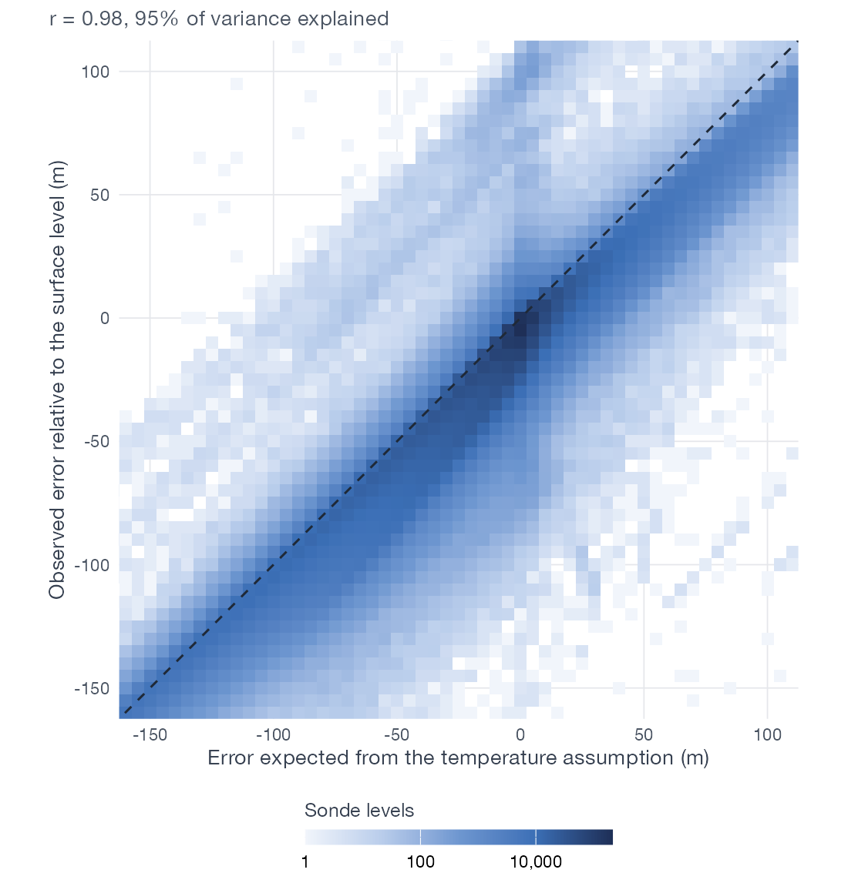

Figure 13: Observed in-flight error (relative to the surface level of the same sounding) against the error expected from the temperature assumption, for sonde levels more than 200 m above the ground. Dashed: 1:1 line.

## A.4 The screen removes errors of the stations, not of ERA5

**The bound is set by what ERA5 can produce.** Where ERA5 needs no extrapolation (flat terrain, station within 30 m of ERA5 orography), 95% of the stations have a \|bias\| below 12.8 m, and the 30 m term is about twice that (<a href="#tbl-basis-flat" class="quarto-xref">Table 8</a>). Over an elevation gap, the radiosondes show that the extrapolation error rarely exceeds a few percent of the gap (<a href="#tbl-basis-gap" class="quarto-xref">Table 9</a>). An offset larger than 30 m plus 10% of the gap is therefore a station error.

Table 8: \|bias\| where ERA5 needs no extrapolation: sub-grid SD \< 20 m and station within 30 m of ERA5 orography (m).

|   n | p50 | p90 |  p95 |  p99 |
|----:|----:|----:|-----:|-----:|
| 719 | 1.8 |   8 | 12.8 | 35.9 |

Table 9: Extrapolation error over a height gap, measured by radiosondes: per-station mean error relative to the surface level, divided by height above the ground.

| height (m)       | stations | median (%) | p99 of \|.\| (%) | max \|.\| (%) |
|:-----------------|---------:|-----------:|-----------------:|--------------:|
| (300,600\]       |      339 |      -0.74 |              9.4 |          20.8 |
| (600,1e+03\]     |      539 |      -0.87 |              7.4 |          36.4 |
| (1e+03,1.5e+03\] |      541 |      -0.93 |              4.3 |          20.3 |
| (1.5e+03,2e+03\] |      308 |      -0.98 |              5.3 |          19.3 |
| (2e+03,3e+03\]   |      474 |      -1.15 |              3.5 |           4.5 |

**Independent checks agree.** 14 excluded stations have another HadISD station within 50 km, and ERA5 fits every one of those neighbours to within 51 m, while the excluded stations are off by up to 1,591 m; conversely, 7 of 45 tested reference stations with \|bias\| \> 15 m share their offset with a neighbour, i.e. real ERA5 errors, mostly in mountains, which are kept. 76 of the 106 implausible offsets are at stations whose elevation a DEM confirms, often in flat terrain next to ERA5’s orography (e.g. Greater Kankakee Airport, Holsworthy Control Range, Strigino), where ERA5 has no mechanism to err. Finally, excluded stations track ERA5 hour by hour (median SD 4.8 m) at a fixed offset, the signature of a station-height error. DEMs are not used as a filter (next section).

**DEMs are not used as a filter**, because they would remove good stations:

- **Coordinates are coarse.** 65% fall on whole arc-minutes (±0.5′, up to ±900 m). A single DEM point can then be off by tens to hundreds of metres in rough terrain.
- **The DEM is therefore sampled on a 5×5 grid over that uncertainty**, in SRTM and ASTER GDEM. An elevation is “refuted” if it lies more than 15 m outside the DEM range in every available DEM.
- **SRTM would not have helped.** The Mapzen tiles used before are SRTM wherever SRTM exists (median difference 0 m).
- **DEMs are only good to ~15 m.** SRTM’s 90% absolute height error is 5–9 m (Rodríguez et al. 2006). SRTM and ASTER differ by a median 5 m (p90 14 m).
- **A DEM filter would remove good stations.** At 162 reference stations the DEM contradicts the listed elevation (median difference 71 m), yet ERA5 reproduces it (median \|bias\| 5.4 m). There, the coordinates are wrong, not the elevation.

**The typical error does not depend on the bound** (<a href="#tbl-sensitivity" class="quarto-xref">Table 10</a>). The medians hardly move with a looser or stricter bound; only the pooled MAE does, driven by a few stations with offsets of hundreds of metres. Loosening the bound to 60 m + 20% adds back 56 stations and raises the MAE from 6.1 to 7.1 m.

Table 10: Ground-level error (m) for looser and stricter bounds (\|bias\| ≤ a + b × gap), with the step-change stations kept or excluded. Used in the report: 30 m + 10%, step-change stations excluded.

| offset rule | step stations | stations | median \|bias\| | p90 \|bias\| | median SD | MAE |
|:---|:---|---:|:---|:---|:---|:---|
| no screen | kept | 2646 | 2.8 | 15.9 | 3.7 | 11.7 |
| no screen | excluded | 2614 | 2.7 | 15.3 | 3.7 | 11.6 |
| 15 m + 5% | kept | 2446 | 2.4 | 9.4 | 3.6 | 5.4 |
| 15 m + 5% | excluded | 2421 | 2.4 | 9.2 | 3.6 | 5.3 |
| 30 m + 10% (used) | kept | 2540 | 2.6 | 11.7 | 3.6 | 6.2 |
| 30 m + 10% (used) | excluded | 2509 | 2.5 | 11.5 | 3.6 | 6.1 |
| 60 m + 20% | kept | 2597 | 2.7 | 13.7 | 3.7 | 7.2 |
| 60 m + 20% | excluded | 2565 | 2.6 | 13.3 | 3.6 | 7.1 |
| 100 m + 30% | kept | 2618 | 2.7 | 14.7 | 3.7 | 7.8 |
| 100 m + 30% | excluded | 2586 | 2.7 | 14.0 | 3.6 | 7.8 |

> [!NOTE]
>
> ### The 144 excluded stations
>
> 

>
> Table 11: Stations excluded from the reference set (m). SRTM/ASTER: DEM at the listed coordinates. DEM refutes: listed elevation more than 15 m outside the DEM range of the coordinate-uncertainty box in every available DEM. Neighbour: median ERA5 bias in 2023 at up to two HadISD stations within 50 km (blank: none, or not tested).
>
> 

>
> | station | reason | elev. | ERA5 orog. | bias | SD | step | from | SRTM | ASTER | DEM refutes | neighbour bias | neighbour km |
> |:---|:---|---:|---:|---:|---:|---:|:---|---:|---:|:---|---:|---:|
> | HERBERT ISLAND | implausible offset | 1605.0 | 47 | -1591.0 | 2.6 |  |  | 0 |  | TRUE | 2.9 | 34 |
> | ERDENI | implausible offset | 2417.0 | 2492 | -1229.9 | 19.1 |  |  | 2427 | 2421 | FALSE |  |  |
> | LAHSH | implausible offset | 1198.0 | 3501 | 816.5 | 26.1 |  |  | 4801 | 4803 | TRUE |  |  |
> | UNKNOWN MONGOLIA | implausible offset | 213.0 | 1097 | 783.1 | 6.0 |  |  | 1143 | 1148 | TRUE |  |  |
> | THREDBO AWS | implausible offset | 1368.0 | 1177 | 582.8 | 11.1 |  |  | 1859 | 1862 | TRUE | 5.8 | 33 |
> | LA ESPERANZA | implausible offset | 1100.0 | 1230 | 564.6 | 5.4 |  |  | 1757 | 1756 | TRUE |  |  |
> | FLAGSTAFF | implausible offset | 2181.6 | 2224 | -485.2 | 16.8 |  |  | 2153 | 2154 | FALSE | -0.8 | 36 |
> | GREATER KANKAKEE AIRPORT | implausible offset | 191.7 | 197 | 406.5 | 16.3 |  |  | 188 | 186 | FALSE |  |  |
> | HOLSWORTHY CONTROL RANGE | implausible offset | 40.0 | 66 | 354.5 | 25.0 |  |  | 29 | 26 | FALSE | -2.6 | 9 |
> | PLAN DE GUADALUPE INTL / SALT | implausible offset | 1456.3 | 1737 | 337.9 | 5.5 |  |  | 1428 | 1420 | TRUE |  |  |
> | COLIMA | implausible offset | 751.9 | 877 | -322.2 | 6.1 |  |  | 748 | 746 | FALSE |  |  |
> | SIVAS | implausible offset | 1285.0 | 1466 | 306.2 | 3.3 |  |  | 1286 | 1287 | FALSE |  |  |
> | BINDER | implausible offset | 747.0 | 1175 | 304.6 | 8.8 |  |  | 1053 | 1040 | TRUE |  |  |
> | KASTAMONU | implausible offset | 1100.0 | 1262 | -301.2 | 5.8 |  |  | 1067 | 1075 | FALSE |  |  |
> | NAZE/FUNCHATOGE | implausible offset | 294.1 | 21 | -284.4 | 2.9 |  |  | 291 | 291 | FALSE |  |  |
> | XINING / CAOJIAPU | implausible offset | 2184.0 | 2656 | 244.8 | 5.6 |  |  | 2173 | 2170 | FALSE |  |  |
> | SHINE USA | implausible offset | 1494.0 | 1456 | 236.8 | 9.0 |  |  | 1224 | 1232 | TRUE |  |  |
> | YAN AN | implausible offset | 959.0 | 1199 | 220.0 | 3.8 |  |  | 991 | 978 | FALSE |  |  |
> | WUJIABA / CHANGSHUI | implausible offset | 2103.0 | 1972 | -218.1 | 4.8 |  |  | 2096 | 2093 | FALSE |  |  |
> | BAYAN DOBO SUMA | implausible offset | 1093.0 | 1103 | 211.8 | 9.0 |  |  | 1027 | 1032 | TRUE |  |  |
> | ULYGAIIN DUGANG | implausible offset | 883.0 | 974 | -208.9 | 8.1 |  |  | 802 | 805 | FALSE |  |  |
> | BAGUIO | implausible offset | 1295.7 | 613 | 206.9 | 6.0 |  |  | 1288 | 1286 | FALSE |  |  |
> | HANBOGD | implausible offset | 914.0 | 1071 | 198.2 | 4.7 |  |  | 1120 | 1128 | TRUE |  |  |
> | YOUYANG | implausible offset | 665.0 | 818 | 163.8 | 4.1 |  |  | 654 | 646 | FALSE |  |  |
> | JIANGBEI | implausible offset | 416.1 | 379 | -152.8 | 4.0 |  |  | 416 | 476 | FALSE |  |  |
> | JIANGCHENG | implausible offset | 1121.0 | 1166 | 144.3 | 3.9 |  |  | 1266 | 1265 | TRUE |  |  |
> | BAM | implausible offset | 940.0 | 958 | 132.8 | 4.7 |  |  | 973 | 966 | TRUE |  |  |
> | LINCANG | implausible offset | 1503.0 | 1831 | 128.6 | 5.0 |  |  | 2712 | 2701 | TRUE |  |  |
> | MARAGHEH | implausible offset | 1478.0 | 1554 | -128.4 | 7.0 |  |  | 1362 | 1373 | TRUE |  |  |
> | TONHIL | implausible offset | 2095.0 | 2094 | 126.7 | 5.3 |  |  | 2242 | 2240 | TRUE |  |  |
> | BOGD | implausible offset | 1646.0 | 1564 | -124.0 | 7.5 |  |  | 1535 | 1528 | TRUE |  |  |
> | URGAMAL | implausible offset | 1263.0 | 1403 | 122.8 | 8.1 |  |  | 1265 | 1264 | FALSE |  |  |
> | PINGLIANG | implausible offset | 1348.0 | 1554 | 117.8 | 4.2 |  |  | 1367 | 1352 | FALSE |  |  |
> | JARTAI | implausible offset | 1143.0 | 1061 | -114.7 | 3.8 |  |  | 1032 | 1032 | TRUE |  |  |
> | SUMBAWANGA | implausible offset | 1923.0 | 1634 | -114.2 | 5.2 |  |  | 1843 | 1834 | TRUE |  |  |
> | AMARBUYANTAYN | implausible offset | 2103.0 | 1745 | 113.5 | 8.0 |  |  | 1919 | 1946 | TRUE |  |  |
> | FRANCISCO SARABIA / TUXTLA GU | implausible offset | 460.0 | 705 | 109.3 | 6.4 |  |  | 459 | 454 | FALSE | -4.5 | 47 |
> | SIMAO | implausible offset | 1303.0 | 1354 | 109.2 | 3.8 |  |  | 1315 | 1321 | FALSE |  |  |
> | KHOY | implausible offset | 1213.4 | 1377 | -108.9 | 7.1 |  |  | 1187 | 1182 | TRUE |  |  |
> | LINDONG | implausible offset | 485.0 | 633 | 101.8 | 3.3 |  |  | 483 | 485 | FALSE |  |  |
> | KASHAN | implausible offset | 1056.1 | 1136 | -100.6 | 6.2 |  |  | 1058 | 1064 | FALSE |  |  |
> | GUIPING | implausible offset | 44.0 | 155 | 87.3 | 3.5 |  |  | 22 | 22 | FALSE |  |  |
> | LONGDONGBAO | implausible offset | 1138.7 | 1234 | 86.0 | 4.0 |  |  | 1133 | 1104 | FALSE |  |  |
> | HIDALGO DEL PARRAL CHIH. | implausible offset | 1661.0 | 1839 | 83.2 | 8.3 |  |  | 1714 | 1713 | TRUE |  |  |
> | MONTANA | implausible offset | 1508.0 | 1820 | -82.4 | 7.0 |  |  | 1450 | 1452 | FALSE | 4.9 | 14 |
> | STRIGINO | implausible offset | 78.0 | 97 | 79.9 | 2.7 |  |  | 74 | 64 | FALSE |  |  |
> | ALPINE-CASPARIS MUNI ARPT | implausible offset | 1375.6 | 1468 | -77.8 | 4.7 |  |  | 1365 | 1345 | FALSE | -5.0 | 32 |
> | COLLINS BAY SASK | implausible offset | 492.0 | 429 | -76.6 | 2.5 |  |  | 498 | 507 | FALSE |  |  |
> | BRATSK | implausible offset | 490.7 | 413 | -75.8 | 2.8 |  |  | 488 | 488 | FALSE |  |  |
> | PRINS CHRISTIAN | implausible offset | 19.0 | 66 | 75.0 | 6.6 |  |  |  |  | FALSE |  |  |
> | PALU/MUTIARA | implausible offset | 6.0 | 268 | 74.6 | 4.5 |  |  | 79 | 79 | FALSE |  |  |
> | KITALE | implausible offset | 1850.1 | 1947 | -73.8 | 8.4 |  |  | 1830 | 1833 | FALSE |  |  |
> | MAKKOVIK | implausible offset | 71.0 | 93 | -72.6 | 88.5 |  |  | 62 | 52 | FALSE |  |  |
> | NUEVA CASAS GRANDES CHIH. | implausible offset | 1487.0 | 1765 | 72.4 | 14.5 |  |  | 1483 | 1483 | FALSE |  |  |
> | FENGNING | implausible offset | 661.0 | 942 | 72.4 | 5.4 |  |  | 732 | 733 | FALSE |  |  |
> | RUO’ERGAI | implausible offset | 3441.0 | 3538 | 70.3 | 6.0 |  |  | 3457 | 3464 | FALSE |  |  |
> | ULSAN | implausible offset | 13.7 | 149 | 70.3 | 3.8 |  |  | 12 | 7 | FALSE | 0.9 | 49 |
> | SUIFENHE | implausible offset | 498.0 | 479 | 69.2 | 2.8 |  |  | 460 | 452 | FALSE | 5.6 | 19 |
> | MECHERIA | implausible offset | 1175.0 | 1144 | -66.6 | 4.2 |  |  | 1111 | 1109 | TRUE | 2.3 | 30 |
> | YANGJIANG | implausible offset | 22.0 | 20 | 66.5 | 2.9 |  |  | 16 | 13 | FALSE |  |  |
> | BAITA | implausible offset | 1083.9 | 1182 | 66.0 | 4.2 |  |  | 1078 | 1069 | FALSE |  |  |
> | KIGOMA | implausible offset | 885.0 | 928 | -64.1 | 5.1 |  |  | 807 | 809 | FALSE |  |  |
> | DIPKARPAZ | implausible offset | 136.0 | 0 | 63.7 | 3.6 |  |  | 150 | 145 | FALSE | -6.6 | 34 |
> | BANMETHUOT | implausible offset | 537.0 | 381 | -63.4 | 7.8 |  |  | 488 | 469 | TRUE |  |  |
> | SABZEVAR | implausible offset | 908.3 | 1161 | 63.1 | 5.4 |  |  | 915 | 914 | FALSE |  |  |
> | NAPO | implausible offset | 794.0 | 911 | 62.3 | 4.5 |  |  | 1174 | 1182 | TRUE |  |  |
> | ZHOUSHUIZI | implausible offset | 32.6 | 23 | 60.7 | 3.6 |  |  | 29 | 19 | FALSE |  |  |
> | MOGOCHA | implausible offset + step change | 625.0 | 750 | 56.9 | 30.2 | 74 | 2022-08 | 625 | 625 | FALSE |  |  |
> | KESHAN | implausible offset | 237.0 | 267 | 55.4 | 3.1 |  |  | 240 | 228 | FALSE |  |  |
> | EL ALTO INTL | implausible offset | 4061.5 | 4047 | -53.5 | 4.5 |  |  | 4037 | 4032 | TRUE |  |  |
> | YUZHNY / TASHKENT ISLAM KARIM | implausible offset | 431.9 | 456 | 53.3 | 3.7 |  |  | 432 | 419 | FALSE |  |  |
> | PRIESTLEY GLACIER | implausible offset | 1924.0 | 1887 | 51.8 | 12.1 |  |  |  | 1992 | TRUE |  |  |
> | POSSESSION IS | implausible offset | 30.0 | -3 | 51.7 | 9.7 |  |  |  |  |  |  |  |
> | GUIUAN | implausible offset | 2.1 | 18 | 51.5 | 3.4 |  |  | 6 | 9 | FALSE |  |  |
> | FRANKSTON (BALLAM PARK) | implausible offset | 110.0 | 108 | -51.4 | 23.0 |  |  | 114 | 103 | FALSE |  |  |
> | KOLTSOVO | implausible offset | 232.9 | 272 | 46.8 | 2.6 |  |  | 227 | 218 | FALSE |  |  |
> | DEHRADUN | implausible offset | 682.0 | 726 | -46.5 | 6.1 |  |  | 655 | 655 | FALSE |  |  |
> | HOVU-AKSY | implausible offset | 1043.0 | 1161 | -46.0 | 5.3 |  |  | 1013 | 999 | FALSE |  |  |
> | BANYUWANGI | implausible offset | 5.0 | 134 | 45.7 | 3.8 |  |  | 2 | 7 | FALSE |  |  |
> | DJELFA/TLETSI | implausible offset | 1144.0 | 1114 | 45.5 | 4.2 |  |  | 1132 | 1138 | FALSE |  |  |
> | GAOUA | implausible offset | 335.0 | 324 | -45.0 | 4.0 |  |  | 315 | 315 | FALSE |  |  |
> | ILAM | implausible offset | 1368.0 | 1364 | -44.9 | 4.3 |  |  | 1328 | 1322 | FALSE |  |  |
> | IRKUTSK | implausible offset | 510.5 | 568 | -44.1 | 3.9 |  |  | 494 | 489 | FALSE |  |  |
> | BAJANAUL | implausible offset | 504.0 | 429 | -44.0 | 3.0 |  |  | 539 | 537 | FALSE |  |  |
> | HONAVAR | implausible offset | 9.0 | 130 | 43.9 | 16.3 |  |  | 20 | 19 | FALSE |  |  |
> | S.A.N.A.E. AWS | implausible offset | 817.0 | 823 | 43.9 | 6.4 |  |  |  | 833 | FALSE |  |  |
> | QINZHOU | implausible offset | 6.0 | 56 | 43.7 | 3.1 |  |  | 8 | 9 | FALSE |  |  |
> | FEZXZAN | implausible offset | 120.0 | 165 | 43.5 | 2.8 |  |  | 115 | 95 | FALSE |  |  |
> | ARAK | implausible offset | 1661.8 | 1791 | 42.9 | 5.9 |  |  | 1654 | 1661 | FALSE |  |  |
> | SAMARKAND | implausible offset | 677.9 | 696 | 42.8 | 4.6 |  |  | 670 | 675 | FALSE |  |  |
> | VILNIUS INTL | implausible offset | 196.9 | 158 | -42.1 | 2.5 |  |  | 180 | 194 | FALSE |  |  |
> | SOHAR MAJIS | implausible offset | 44.0 | -12 | -41.4 | 2.8 |  |  | 35 | 30 | FALSE |  |  |
> | MONCLOVA INTL | implausible offset | 568.1 | 661 | 41.1 | 11.9 |  |  | 566 | 572 | FALSE |  |  |
> | XINZHENG | implausible offset | 150.9 | 127 | -40.7 | 3.6 |  |  | 149 | 154 | FALSE |  |  |
> | DUSHAN | implausible offset | 971.0 | 945 | 40.3 | 4.0 |  |  | 1009 | 1009 | FALSE |  |  |
> | SAM-NEUA | implausible offset | 1000.0 | 1074 | -39.8 | 8.4 |  |  | 971 | 971 | FALSE |  |  |
> | SEVCENKO | implausible offset | 15.0 | -18 | -39.3 | 4.0 |  |  | -29 | -28 | TRUE | -50.5 | 31 |
> | RUTENG/SATAR TACIK | step change | 1170.0 | 484 | -37.5 | 5.6 | 10 | 2022-08 | 1482 | 1475 | TRUE |  |  |
> | JOAO PESSOA | implausible offset | 7.0 | 11 | 36.9 | 3.7 |  |  | 12 | 20 | FALSE |  |  |
> | XIAOSHAN | implausible offset | 7.0 | 1 | 36.5 | 3.4 |  |  | 5 | 14 | FALSE |  |  |
> | UIL | implausible offset | 128.0 | 100 | -35.1 | 3.5 |  |  | 62 | 63 | TRUE |  |  |
> | P C PELSER | implausible offset | 1354.5 | 1377 | -35.0 | 6.6 |  |  | 1362 | 1356 | FALSE |  |  |
> | LITANG | step change | 3950.0 | 4387 | 34.1 | 28.0 | 56 | 2023-01 | 3963 | 3971 | FALSE |  |  |
> | TUKTUT NOGAIT NWT | implausible offset | 522.0 | 559 | 33.9 | 4.1 |  |  |  | 561 | FALSE |  |  |
> | KOSTANAY | implausible offset | 181.4 | 178 | -33.2 | 3.1 |  |  | 177 | 165 | FALSE |  |  |
> | BALDRICK AWS | implausible offset | 1968.0 | 1965 | 32.3 | 6.3 |  |  |  | 2980 | TRUE |  |  |
> | NATITINGOU | implausible offset | 461.0 | 455 | -32.2 | 4.8 |  |  | 460 | 466 | FALSE |  |  |
> | TUXPAN.VER. | implausible offset | 28.0 | 21 | -30.7 | 8.1 |  |  | 9 | 13 | FALSE |  |  |
> | VAN | step change | 1670.3 | 1814 | -28.5 | 10.9 | 20 | 2023-11 | 1654 | 1653 | FALSE |  |  |
> | WU LU MU QI | step change | 919.0 | 1077 | 27.6 | 29.0 | 77 | 2024-07 | 892 | 903 | FALSE |  |  |
> | AGRI AHMED I HANI | step change | 1664.8 | 1897 | -25.7 | 7.1 | -16 | 2022-09 | 1666 | 1663 | FALSE |  |  |
> | LICHINGA | step change | 1373.1 | 1127 | -25.7 | 12.8 | 24 | 2023-04 | 1366 | 1363 | FALSE |  |  |
> | JOSE MARIA CORDOVA | step change | 2142.1 | 2033 | -24.2 | 7.1 | -14 | 2022-08 | 2122 | 2134 | FALSE | -9.7 | 20 |
> | XIFENGZHEN | step change | 1423.0 | 1250 | -23.4 | 26.6 | -56 | 2024-01 | 1414 | 1422 | FALSE |  |  |
> | MATAVERI INTL | step change | 69.2 | 8 | -22.3 | 11.5 | 26 | 2024-06 | 59 | 40 | FALSE |  |  |
> | EMBU | step change | 1493.0 | 1433 | 18.8 | 8.5 | -16 | 2023-03 | 1500 | 1483 | FALSE |  |  |
> | ELDORET | step change | 2120.0 | 2127 | -16.2 | 24.5 | 48 | 2023-05 | 2143 | 2138 | FALSE |  |  |
> | CAPE COLUMBINE | step change | 67.0 | 3 | -15.7 | 4.6 | -13 | 2022-09 | 5 | 6 | FALSE | 2.8 | 33 |
> | UC-ARAL | gross errors | 397.0 | 428 | -15.7 | 17.2 |  |  | 393 | 384 | FALSE |  |  |
> | NYERI | step change | 1759.0 | 2005 | -13.2 | 25.1 | 52 | 2023-02 | 1801 | 1795 | FALSE |  |  |
> | TERMINILLO MOUNTAIN | gross errors | 1875.0 | 1017 | -13.0 | 51.4 |  |  | 1889 | 1881 | FALSE |  |  |
> | ANIAK AIRPORT | step change | 25.9 | 110 | -13.0 | 6.6 | 16 | 2024-07 |  | 17 | FALSE |  |  |
> | NAKURU | step change | 1901.0 | 2006 | -12.9 | 20.4 | 49 | 2022-09 | 1923 | 1928 | FALSE |  |  |
> | CAPE AGULHAS | step change | 14.0 | 7 | -12.1 | 6.5 | -14 | 2023-02 | 0 |  | FALSE |  |  |
> | DESERT ROCK AIRPORT | step change | 984.5 | 1238 | 12.0 | 14.1 | 24 | 2023-12 | 993 | 985 | FALSE |  |  |
> | IRINGA | step change | 1425.9 | 1607 | -10.0 | 11.1 | -20 | 2023-09 | 1419 | 1408 | FALSE |  |  |
> | LA VETA PASS AWOS-3 ARPT | step change | 3114.1 | 2651 | -8.3 | 17.6 | -32 | 2023-11 | 2844 | 2863 | TRUE |  |  |
> | SHEFFIELD SCHOOL FARM | step change | 295.0 | 534 | -8.3 | 9.1 | -17 | 2023-02 | 266 | 253 | FALSE |  |  |
> | SUPUNG | step change | 76.0 | 303 | -8.3 | 8.5 | -15 | 2024-01 | 67 | 71 | FALSE |  |  |
> | BASSATINE | step change | 576.1 | 434 | -8.0 | 7.7 | -15 | 2023-01 | 563 | 562 | FALSE |  |  |
> | GIOIA DEL COLLE | step change | 361.8 | 253 | -7.7 | 6.7 | -14 | 2024-05 | 342 | 342 | TRUE |  |  |
> | DOME PLATEAU DOME A | gross errors | 4084.0 | 4056 | 6.7 | 7.0 |  |  |  | 2763 | TRUE |  |  |
> | MTHATHA | gross errors | 731.5 | 885 | 6.4 | 12.5 |  |  | 738 | 742 | FALSE |  |  |
> | LITTLE CHICAGO NWT | step change | 63.0 | 211 | -6.4 | 9.2 | 14 | 2022-08 |  | 60 | FALSE |  |  |
> | MIDELT | gross errors | 1515.0 | 1541 | -5.5 | 4.6 |  |  | 1464 | 1462 | TRUE |  |  |
> | PREITENEGG | step change | 1035.0 | 886 | 4.2 | 13.1 | 29 | 2024-03 | 950 | 950 | FALSE |  |  |
> | RUSTON REGIONAL AIRPORT | step change | 94.8 | 69 | -3.7 | 6.7 | 12 | 2022-11 | 91 | 42 | FALSE |  |  |
> | YOHO PARK BC | step change | 1602.0 | 2259 | 3.6 | 10.6 | -16 | 2022-08 | 1924 | 1918 | FALSE |  |  |
> | FRUHOLMEN FYR | step change | 14.2 | -2 | 3.4 | 7.1 | 12 | 2024-06 |  |  |  |  |  |
> | PBO ANANTAPUR | step change | 364.0 | 373 | 3.3 | 10.3 | 22 | 2022-09 | 377 | 368 | FALSE |  |  |
> | SINOP | step change | 32.0 | 15 | -2.9 | 5.7 | -11 | 2022-10 | 198 | 196 | FALSE |  |  |
> | CONAKRY / AHMED SEKOU TOURE I | gross errors | 21.9 | 1 | 0.7 | 4.3 |  |  | 17 | 34 | FALSE |  |  |
> | CORK | step change | 153.0 | 44 | -0.6 | 8.0 | -15 | 2022-12 | 141 | 97 | FALSE |  |  |
> | CABO FRIO | gross errors | 4.3 | 6 | -0.2 | 2.2 |  |  | 3 | 7 | FALSE |  |  |
>
> 

>
> 

## A.5 No sign that assimilation flatters ERA5

- **Stations never assimilated fit as well as assimilated ones** (<a href="#tbl-assim" class="quarto-xref">Table 12</a>). In the same terrain class, the GNSS stations have the same median \|bias\| and SD as HadISD; the few Swiss stations absent from ISD are too few to tell.
- **Isolated stations do not fit better** (<a href="#tbl-density" class="quarto-xref">Table 13</a>). An isolated observation weighs most in ERA5’s analysis, so overfitting would show there first. In flat terrain, the opposite holds: HadISD stations with at most two other stations within 300 km have a median SD of 3.2 m, those with more than 30 neighbours 2.7 m, which reflects better-constrained analyses in dense networks.

Table 12: Median \|bias\| / median SD (m) and number of stations by terrain roughness, for assimilated (HadISD, MeteoSwiss in ISD) and never or probably not assimilated stations (GNSS, MeteoSwiss not in ISD), ERA5 single-levels.

| terrain | GNSS, height-checked | HadISD reference set | MeteoSwiss, in ISD | MeteoSwiss, not in ISD |
|:---|:---|:---|:---|:---|
| flat (\<20 m) | 2.5 / 2.5 (15) | 1.9 / 3.1 (870) |  |  |
| gentle (20-50 m) | 1.2 / 2.7 (8) | 2.5 / 3.3 (493) |  |  |
| hilly (50-150 m) | 1.7 / 3.1 (18) | 3.2 / 4.2 (622) | 2.4 / 2.9 (24) | 2.0 / 2.9 (1) |
| rough (150-300 m) | 5.3 / 3.9 (3) | 4.7 / 5.8 (373) | 1.9 / 4.1 (42) | 1.7 / 4.2 (2) |
| mountain (\>300 m) | 9.4 / 9.0 (3) | 6.1 / 8.5 (144) | 5.0 / 9.6 (63) | 7.0 / 10.0 (6) |

Table 13: Ground-level error of the HadISD reference stations in flat terrain (sub-grid SD \< 20 m), by the number of other HadISD stations within 300 km (m).

| stations within 300 km | stations | median \|bias\| | median SD |
|:-----------------------|---------:|:----------------|:----------|
| 0-2                    |      184 | 2.1             | 3.2       |
| 3-10                   |      309 | 2.2             | 3.4       |
| 11-30                  |      203 | 1.8             | 2.9       |
| \>30                   |      174 | 1.5             | 2.7       |

# Appendix B: supplementary figures

**Geography of the error once the elevation gap is accounted for** (<a href="#fig-map-residual" class="quarto-xref">Figure 14</a>).

- **Accuracy: biases form regional patches of a few metres** (<a href="#fig-map-residual" class="quarto-xref">Figure 14</a> a), for example negative in southern Africa and along the Andes and positive in Southeast Asia, without a global pattern.
- **Precision: a clear regional pattern remains once the elevation gap is accounted for** (<a href="#fig-map-residual" class="quarto-xref">Figure 14</a> b). The SD is lower than expected from the elevation gap in Europe, Australia and on oceanic islands, and higher in Central and South Asia, the Sahel, southern South America and the polar regions.

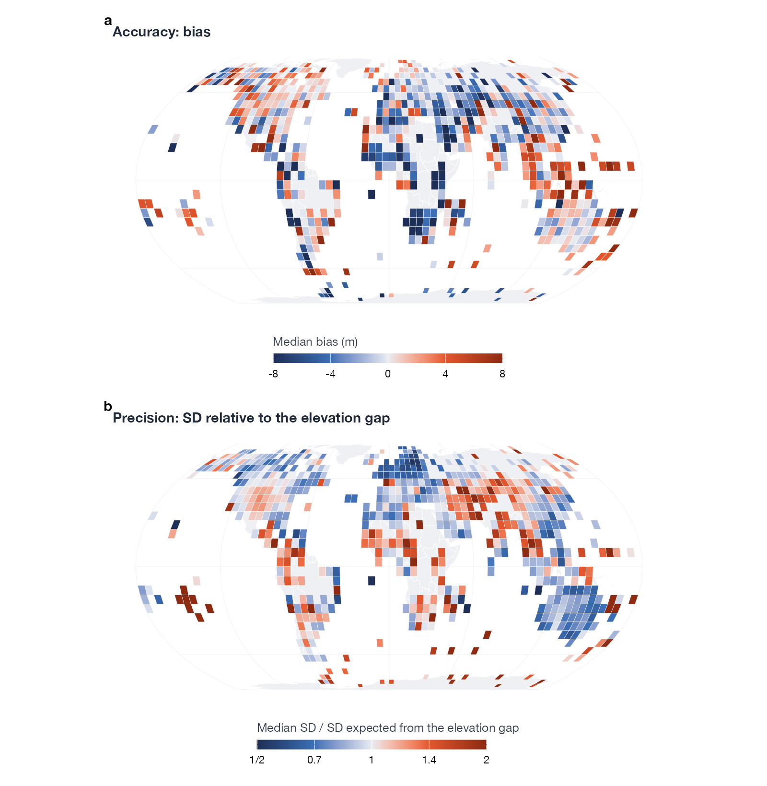

Figure 14: Median over 5°×5° cells of (a) the station bias and (b) the station SD divided by the SD expected from its elevation gap, HadISD reference set. Colours clipped at ±8 m and ×2.

**Bias and SD per station** (<a href="#fig-maps" class="quarto-xref">Figure 15</a>), before the aggregation to 5° cells of <a href="#fig-map-residual" class="quarto-xref">Figure 14</a>.

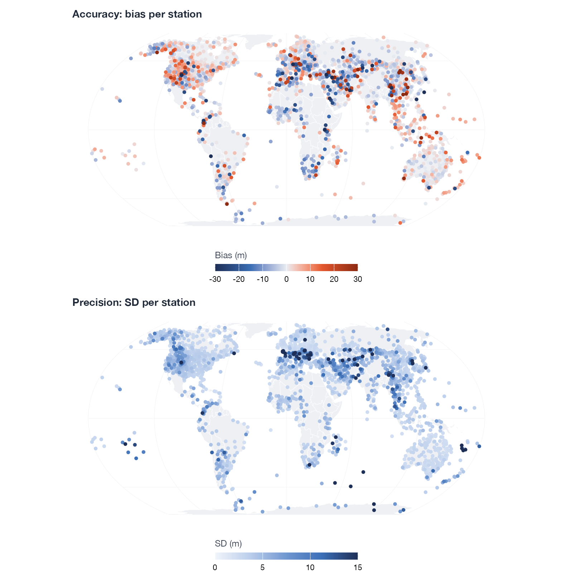

Figure 15: Bias (top) and SD (bottom) per station, HadISD reference set, ERA5 single-levels. Colours clipped at ±30 m and 15 m.

**In flight, the bias is two to four times larger at night than during the day** (<a href="#fig-daynight" class="quarto-xref">Figure 16</a>), at 1–1.5 km -20.2 m against -5.0 m in the summer half-year. Nocturnal inversions make the real column warmer than assumed, which matters for the many species that migrate at night.

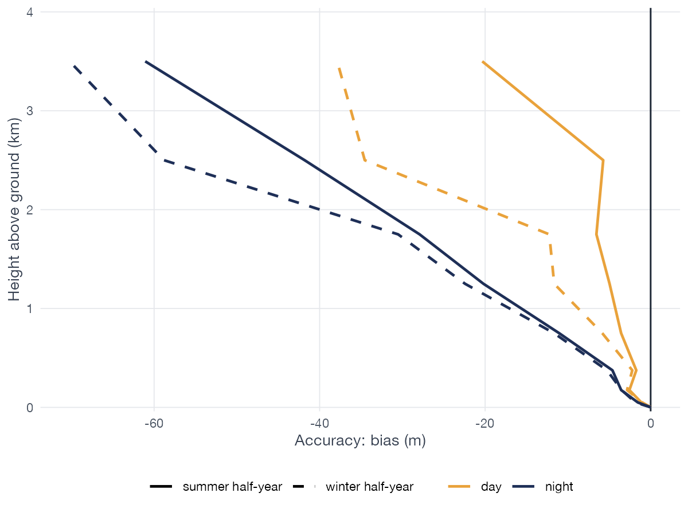

Figure 16: In-flight bias by day (07–19 h local solar time) and night, and by half-year, up to 4 km (ERA5 single-levels). Solid: summer; dashed: winter.

**In flight, ERA5-Land and ERA5 single-levels behave alike** (<a href="#fig-land-flight" class="quarto-xref">Figure 17</a>): relative to the surface, the offset of ERA5-Land’s reference level cancels.

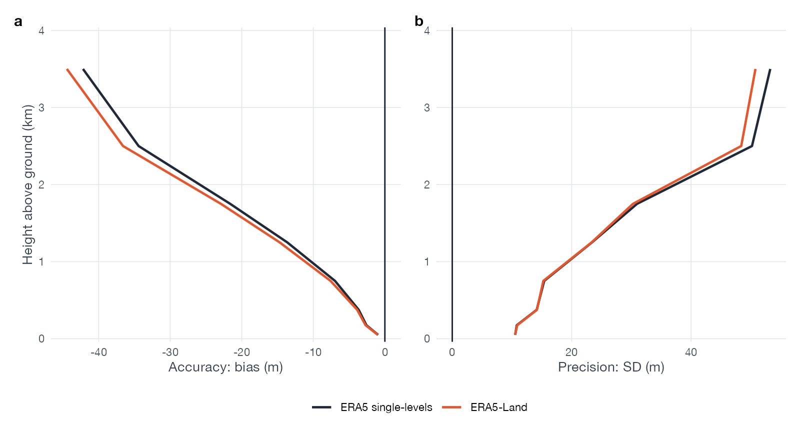

Figure 17: In-flight bias (a) and SD (b) against height, up to 4 km, with ERA5 single-levels and ERA5-Land.

