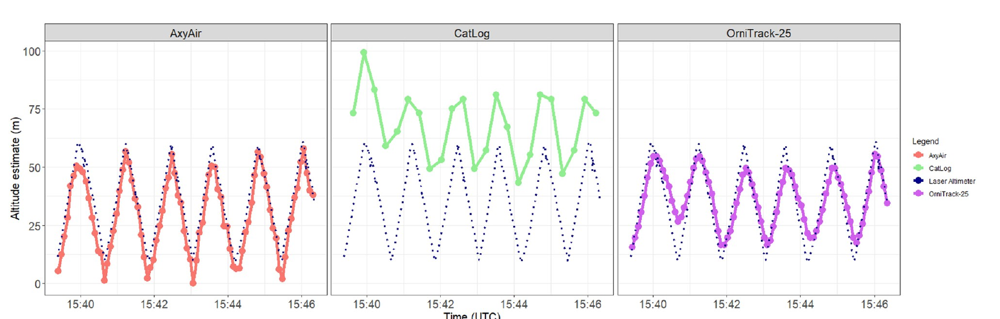
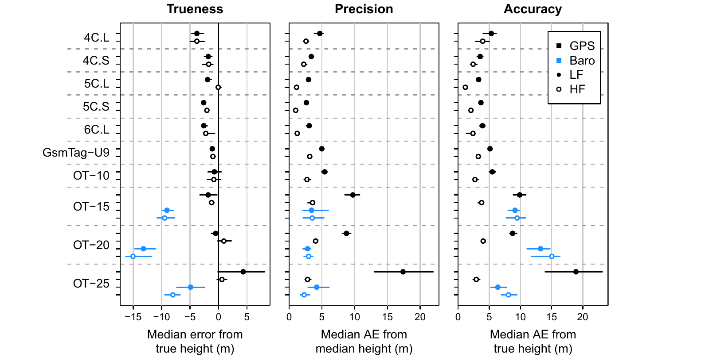
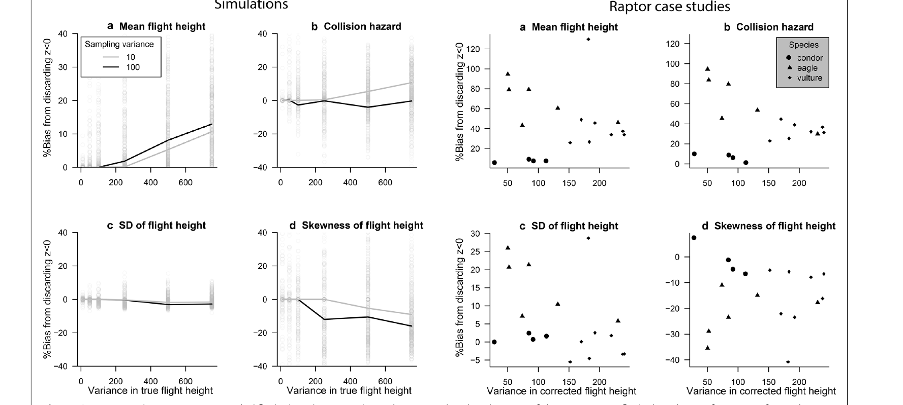
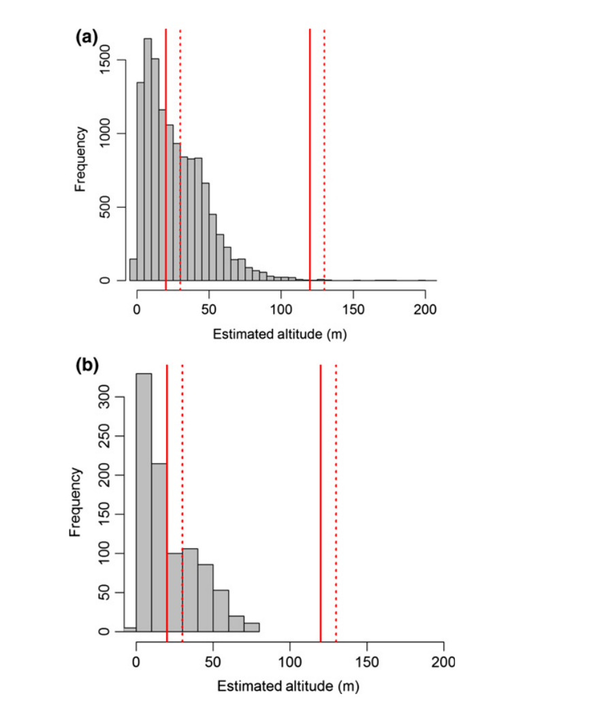
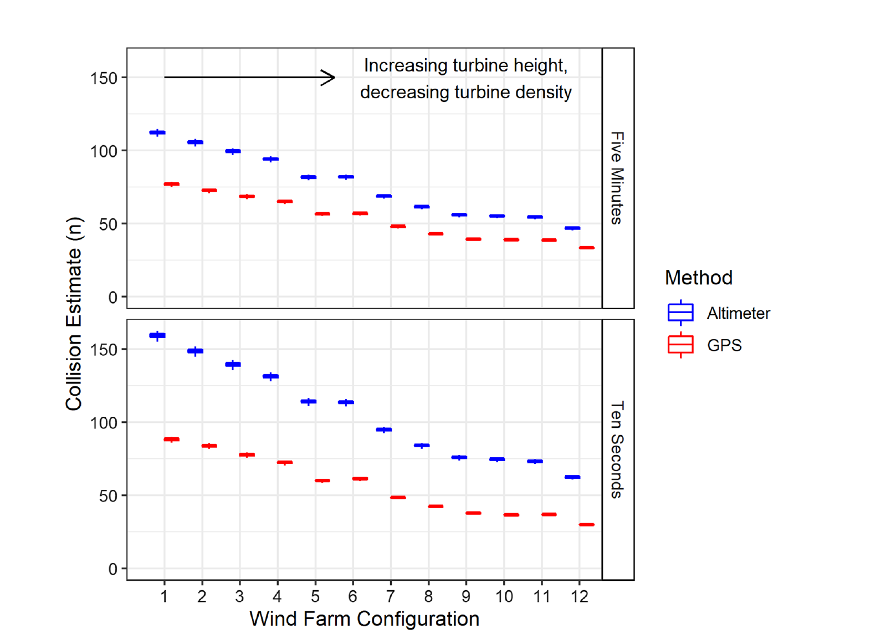
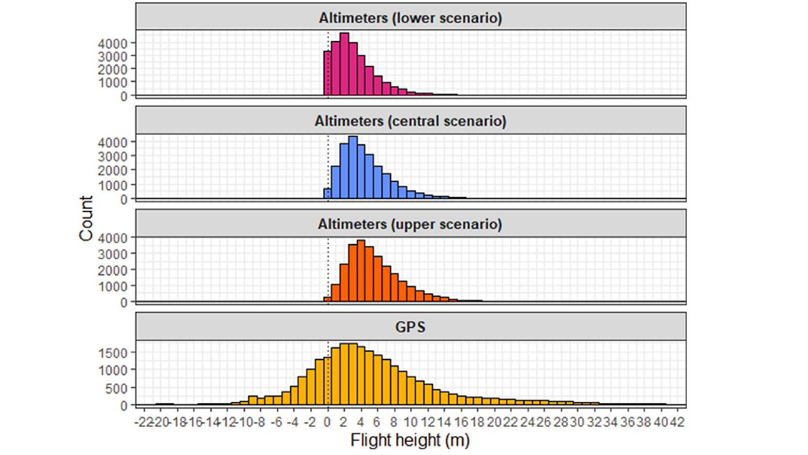

# GPS, barometers and animal flight height

Evidence relevant to the scope of the altitude-validation paper. Prepared 18 October 2026; retained as a literature-review record. Subsequent manuscript decisions are tracked in [the response plan](../../archive/docs/manuscript/comment-response-plan.md).

## Purpose and reading guide

This report asks whether the introduction and stated relevance of our paper should include barometers carried by GPS-equipped animal tags. It concentrates on animal ecology, especially bird flight, rather than surveying navigation engineering. The study summaries below distinguish the authors' findings and claims from my assessment, which comes at the end. No manuscript changes have been implemented.

This is a targeted, full-text synthesis of ten studies, supported by the broader T01–T03 review. It is not a systematic review or a quantitative meta-analysis. The emphasis on seabirds and raptors reflects the particularly developed literature on flight height and wind-energy assessment; pigeons and frigatebirds provide examples of other biological questions. Publication coverage was checked through 18 October 2026. A detailed source and figure record accompanies the report in `gps-barometer-sources.md` and `docs/assets/gps-barometer/manifest.json`.

### Three measurements often called “GPS altitude”

1. **Satellite-derived altitude:** the GPS/GNSS receiver estimates the vertical coordinate from satellite signals. Sampling mode, satellite geometry, receiver algorithms and reference datum affect its quality.
2. **Pressure-derived altitude in a GPS-equipped tag:** a separate barometer measures pressure. GPS supplies the horizontal position used to obtain weather or terrain information; a pressure-to-height conversion supplies the vertical coordinate. It is not a GPS vertical measurement.
3. **Pressure-derived altitude in a small multisensor geolocator:** the same atmospheric physics applies, but horizontal location is estimated by another workflow and can be much less certain. Sensor size, power, sampling and opportunities for calibration also differ.

Here, **altitude** means height relative to a stated vertical datum, usually mean sea level. **Height above ground** additionally requires terrain elevation at the animal's horizontal position. Sea-surface height, mean sea level, ellipsoidal height and ground-relative height should not be treated as interchangeable.

### What counts as evidence?

An independent reference, such as a laser measuring distance to the ground, can test height error in the trial conditions. A bird known to be on the ground provides an approximate zero-height reference. Agreement between airborne GPS and barometric estimates only measures their difference: either or both can be wrong. Finally, a change in behavioural classification or modelled collision risk demonstrates ecological sensitivity to height estimates, without establishing which sensor is correct. The numerical results below retain their original metrics; they should not be pooled into a single accuracy ranking.

## Study summaries: measurement and validation

### 1. Lato et al. (2022): controlled comparison against a laser

**Paper:** [Assessing the accuracy of altitude estimates in avian biologging devices](https://doi.org/10.1371/journal.pone.0276098), *PLOS ONE*.

**Question and design.** Can commonly used bird loggers recover low flight heights and vertical movements? A drone carried an AxyAir pressure logger, CatLog and OrniTrack-25 GPS loggers, and an independent downward-looking laser altimeter. Trials included stationary heights from 2 to 50 m, horizontal movement near 10 m and repeated vertical movements between approximately 10 and 60 m. The barometric conversion used a local ground-pressure reference and logger temperature. These were controlled device trials, not free-flying bird deployments.

**Main results.** The abstract reports a barometric mean error of 1.57 m. During horizontal trials, the GPS devices overestimated height by reported mean errors of 6.5 m and 40.96 m. Those are the authors' mean-error statistics, not interchangeable MAEs or RMSEs. The pressure logger followed vertical cycles well; GPS performance differed greatly between devices. CatLog's irregular, slower-than-programmed recording contributed to missed or distorted movements.

**Authors' claim and its reach.** Barometric loggers can resolve fine vertical movements better than the tested GPS configurations. The result is supported by an independent height reference, but applies to a locally referenced, low-altitude experiment with specific devices and settings. It does not estimate annual, global, weather-driven error or establish an inherent inferiority of all GPS receivers. See Methods, stationary/horizontal/vertical trial results, and Figures 5–6.

*Repeated vertical movement in the drone trial. The dashed laser reference lets the reader distinguish recovered cycles from device offset and lag. AxyAir follows the reference closely; performance differs between the two GPS devices. Source: Lato et al. (2022), Figure 5, CC BY 4.0; cropped from PDF page 10, scientific content unchanged.*

### 2. Schaub et al. (2023): GPS mode matters, and pressure bias remains

**Paper:** [How to improve the accuracy of height data from bird tracking devices? An assessment of high-frequency GPS tracking and barometric altimetry in field conditions](https://doi.org/10.1186/s40317-023-00342-1), *Animal Biotelemetry*.

**Question and design.** The study compared low-frequency GPS, high-frequency GPS and barometers in free-living harriers and red kites. It included 194 tags of 10 models on 204 individuals and approximately 11 million GPS positions. Low-frequency fixes were at least five minutes apart, with receivers switched off between fixes; high-frequency fixes were approximately 2–3 seconds apart, with receivers remaining on. Grounded birds supplied approximate known zero heights. GPS–barometer differences during flight supplied an additional, indirect comparison.

**Main results.** Mean absolute GPS errors were 7.4–29.9 m in low-frequency mode and 1.5–7.0 m in high-frequency mode, an average reduction of about 72%. Barometric estimates were relatively smooth but biased low: approximately −15 to −5 m, with stationary mean absolute errors of 6.8–15.2 m. Thus, barometers were not universally more accurate than GPS. Smaller airborne differences between the two sensors suggested that pressure bias could differ between stationary and flying conditions; airborne truth was not independently known.

**Authors' claim and its reach.** High-frequency GPS offered the best accuracy in these field comparisons, while barometers traded low noise for possible systematic error. Importantly for our paper, their barometric implementation already used ERA5 pressure and temperature and a lapse rate estimated between the surface and a pressure level: 950 hPa for red kites and 975 hPa for marsh harriers. It was not simply an uncorrected standard atmosphere. See main Methods/Results, Figure 2 and Additional file 1, barometric-height calculation. Our fixed-lapse ERA5 baseline therefore does not reproduce their full method.

*Grounded-bird comparisons separate bias, spread around the median, and absolute error relative to the known ground height. Black is GPS, blue barometric; open and filled symbols distinguish sampling modes. The figure uses median absolute-error measures, whereas the numerical ranges in the text above are mean absolute errors. Source: Schaub et al. (2023), Figure 2, CC BY 4.0; cropped from PDF page 7.*

### 3. Péron et al. (2020): the complete height-error chain

**Paper:** [The challenges of estimating the distribution of flight heights from telemetry or altimetry data](https://doi.org/10.1186/s40317-020-00194-z), *Animal Biotelemetry*.

**Question and design.** This methodological synthesis combines controlled device tests, simulations and raptor case studies to ask how measurement errors alter flight-height distributions. It follows error through satellite height, pressure calibration, horizontal position, terrain elevation, data filtering and statistical inference. Its target is the distribution of animal heights, not just an instrument's mean bias.

**Main results.** In the pressure comparison, the standard deviations of differences between recalibrated barometric height and GPS, default barometric height or a drone altimeter were approximately 22, 14 and 19 m, respectively. These are disagreement statistics, not three independent absolute-accuracy estimates. Simulations showed how terrain and position errors could greatly amplify ground-relative height uncertainty. Removing negative height estimates distorted mean heights, distribution shape and collision-risk quantities; negative records contain information about error rather than being automatically disposable mistakes.

**Authors' claim and its reach.** Ecological inference should model the measurement process and retain information about uncertainty. Improving one component does not resolve all sources of height error. Simulated effects depend on the assumed terrain, distributions and noise. In the raptor reanalyses, corrected height is a model-based reference, not independently observed airborne truth. See experimental tests, the negative-height section, Figure 3 and the proposed state-space framework.

*Consequences of deleting negative height estimates. Left panels use simulations with known truth; right panels use raptor case studies with model-corrected heights as the reference. Filtering changes means, collision hazard, spread and skewness. Source: Péron et al. (2020), Figure 3, CC BY 4.0; cropped from PDF page 7.*

### 4. Ross-Smith et al. (2016): ecological inference from noisy GPS height

**Paper:** [Modelling flight heights of lesser black-backed gulls and great skuas from GPS: a Bayesian approach](https://doi.org/10.1111/1365-2664.12760), *Journal of Applied Ecology*.

**Question and design.** Can GPS-derived heights reveal seabird flight-height distributions after explicitly accounting for observation error? The authors used a Bayesian state-space approach with GPS quality information to estimate underlying heights in lesser black-backed gulls and great skuas, then examined time of day, landscape and overlap with turbine rotor heights. This is a GPS-only modelling precedent, not a pressure-sensor validation.

**Main results.** Gull heights varied with context: lower at night than by day, higher over land and lower near the coast. Comparable time/location relationships were not significant in great skuas. Estimates of overlap depended on the rotor-height window; for one 22–250 m window, estimates reached about 34% for gulls and 9% for skuas. These are modelled proportions within a height band, not collision probabilities or mortality measurements.

**Authors' claim and its reach.** Useful ecological height distributions can be estimated from GPS when observation error is modelled. The result counters the idea that noisy individual GPS fixes make the whole dataset biologically uninformative. It does not show that any particular pressure conversion is accurate. Useful figures are the posterior flight-height distributions, rotor-band comparisons and the error-versus-GPS-quality relationship (Figures 1–6 in the accepted manuscript; Figure 5 for band overlap).

## Study summaries: biological applications and calibration choices

### 5. Cleasby et al. (2015): behaviour-specific gannet flight heights

**Paper:** [Three-dimensional tracking of a wide-ranging marine predator: flight heights and vulnerability to offshore wind farms](https://doi.org/10.1111/1365-2664.12529), *Journal of Applied Ecology*.

**Question and design.** GPS locations and pressure loggers were combined to examine how northern gannet flight heights differ between commuting and foraging. The height-logger dataset comprised 16 birds and 54 trips; it should not be confused with the larger GPS-only dataset also used in the paper. Pressure was referenced locally using floating/take-off events, or known colony height at the beginning of a trip. The processing accounted for diving and brief take-off/landing transients.

**Main results.** Median commuting height was 11.5 m, compared with 26.5 m during foraging. Using a single colony pressure reference for a whole trip produced heights around 40% higher and weaker GPS–barometer correspondence than local calibration. Collision-model outputs could differ by up to approximately twelvefold from estimates based on other flight-height data. That is a sensitivity of predicted mortality to inputs and model assumptions, not observed turbine deaths.

**Authors' claim and its reach.** Combining horizontal movement and altitude reveals behaviour-specific exposure that simple species-wide flight-height averages miss. Repeated local sea-level references are central to the method's performance. This is a strong ecological use of pressure-derived height and a clear calibration precedent; it is not a test of a globally transferable atmosphere-only conversion. See altitude calibration, flight-height results, Figure 5 and the collision-model analysis.

*Estimated gannet height distributions for all visited locations (a) and locations within proposed wind-farm areas (b). Red lines mark rotor-height envelopes used in the analysis. The low-altitude distribution makes the calibration and its tails consequential. Source: Cleasby et al. (2015), Figure 5, CC BY 4.0; cropped from PDF page 5.*

### 6. Johnston et al. (2023): sensor choice changes modelled collision risk

**Paper:** [Flight heights obtained from GPS versus altimeters influence estimates of collision risk with offshore wind turbines in Lesser Black-backed Gulls](https://doi.org/10.1186/s40462-023-00431-z), *Movement Ecology*.

**Question and design.** The study compared co-recorded GPS and pressure-derived flight heights in gulls and propagated each into offshore-wind collision models. Pressure observations were processed with temperature information and ERA5 sea-level pressure, calibrated against floating periods; records too distant in time from a suitable floating reference were excluded. Tide corrections linked the water-surface reference to mean sea level. Five-minute and ten-second GPS sampling datasets were analysed separately.

**Main results.** Pressure-derived heights were higher than GPS heights by an average of 4.40 m in the five-minute dataset and 11.45 m in the ten-second dataset. These are differences between methods, not independently measured sensor errors. Pressure-based heights produced higher collision estimates across twelve hypothetical wind-farm configurations, with the magnitude depending on sampling dataset and turbine configuration.

**Authors' claim and its reach.** Height-estimation method can materially change conservation assessments, so method choice and calibration must be reported. The study shows a practical consequence of disagreement, rather than identifying the true height of each airborne bird. Predicted collisions remain conditional on the collision model, flight distributions, avoidance and turbine assumptions. See altitude calibration and tide adjustment, the flight-height comparisons, and Figure 6.

*Modelled monthly collisions for twelve hypothetical wind-farm configurations, using barometric (blue) or GPS (red) heights. Top and bottom panels concern different sampling datasets; they are not a controlled experiment changing only fix frequency. These are model outputs, not observed collision counts. Source: Johnston et al. (2023), Figure 6, CC BY 4.0; cropped from PDF page 10.*

### 7. Miller, Hamilton & Clarke (2026): albatross dynamic soaring as a reference

**Paper:** [Altimeters on albatrosses: quantifying flight heights for dynamic soaring seabirds](https://doi.org/10.1017/S095927092610063X), *Bird Conservation International*.

**Question and design.** Can the low points of dynamic-soaring cycles supply a sea-level pressure reference when conventional calibration opportunities are limited? GPS and pressure were recorded at 1 Hz in five-minute bursts. Only three of eleven deployed loggers returned data. Lower, central and upper scenarios varied the assumed reference pressure within each burst. The method relies on low points of soaring cycles approaching the sea surface.

**Main results.** For flying bursts, the central barometric scenario gave a mean height of 4.48 m and SD 2.89 m, versus GPS mean 5.10 m and SD 9.72 m. Mean barometric heights ranged from 3.23 to 5.61 m across calibration scenarios. Both sensors detected roughly ten-second soaring cycles, but their height distributions differed sharply. The lower-to-upper scenario range reflects calibration assumptions, not an independent accuracy interval. Floating-bird wave signals offered a supporting plausibility check, not an airborne height reference.

**Authors' claim and its reach.** Behaviour can provide useful pressure calibration for dynamic-soaring seabirds and improve the description of low flight-height distributions. The small returned sample limits species-level generalisation, and the assumed proximity of cycle minima to the surface remains consequential. A narrow, non-negative pressure-derived distribution cannot on its own establish greater absolute accuracy. See Figure 2 for calibration scenarios, Figure 3 and Table 1 for distributions, and Figure 5 for wave comparisons.

*Three barometric calibration scenarios and GPS-derived heights in flying shy albatrosses. Means are similar in the central comparison, but spread and skewness differ substantially. Source: Miller, Hamilton & Clarke (2026), Figure 3, CC BY 4.0; cropped from PDF page 6.*

### 8. Clark et al. (2019): altitude changes the interpretation of foraging

**Paper:** [First three-dimensional tracks for the Ascension Frigatebird highlight the importance of altitude for behavioural studies](https://doi.org/10.61350/sbj.32.1), *Seabird* 32. The issue is dated 2019; some bibliographic services register a later publication date.

**Question and design.** Three female Ascension frigatebirds carried GPS and barometric loggers. Hidden Markov models were fitted to two-dimensional movement and then to movement including altitude. The authors also compared behavioural inference when altitude came from pressure or GPS. Pressure was referenced using 48 hours at the nest, with nest altitude taken from the modal GPS altitude; that reference is not an independent survey. This asks what the vertical dimension adds to biology, rather than primarily how many metres a sensor is wrong.

**Main results.** Mean pressure-derived flight altitude was 178 m and individual maxima were 1,658–1,871 m. A two-dimensional model assigned 59.5% of locations to a search-like state. Including altitude identified a high-altitude soaring/thermalling state (3.4%) and separated mid-altitude (44.7%) from low-altitude (12.2%) search-like behaviour. GPS and barometric altitudes were strongly correlated, r = 0.94, and state assignments agreed for 88% of locations.

**Authors' claim and its reach.** Slow, tortuous horizontal movement can represent soaring as well as prey searching; altitude helps distinguish these processes. Either altitude source supported similar broad inference in this small sample. The labels remain putative behavioural states: low-altitude search was not a direct observation of prey capture. Figure 3 is the most useful visual comparison: the same trip coloured by states from 2D, pressure-based 3D and GPS-based 3D models; Figure 6 compares the altitude sources. This is an instructive case where biological scale makes a strong sensor ranking less important.

### 9. Lempidakis et al. (2024): fine height variation and flight mechanics

**Paper:** [Turbulence causes kinematic and behavioural adjustments in a flapping flier](https://doi.org/10.1098/rsif.2023.0591), *Journal of the Royal Society Interface*.

**Question and design.** Homing pigeons carried GPS, accelerometers and pressure sensors to test how turbulence affects flight mechanics. Pressure was recorded at 20 Hz, converted to altitude with a release-site pressure reference, smoothed over two seconds and combined with a surface-elevation model. Fine-scale height variation was used as a turbulence proxy and related to wingbeat kinematics. This was a biological application, not an independent altimeter validation.

**Main results.** Turbulence was associated with a small increase in mean wingbeat amplitude and a decrease in mean wingbeat frequency, leaving mean flapping wing speed approximately unchanged. More pronounced responses occurred in stroke-to-stroke variability of frequency and amplitude. Pigeons made only small adjustments to flight altitude. The authors interpret the variable kinematics as compensation for turbulence, with likely energetic consequences; this is not a direct measurement of metabolic expenditure.

**Authors' claim and its reach.** Variation within flight can reveal responses missed by mean flight parameters. Pressure-based height can therefore contribute to biomechanics as well as migration or collision assessment. Because height variation also defines the turbulence proxy, this study does not independently validate pressure-derived fluctuations against true turbulence or true height. Figures 1–2 explain the tracks and proxy; Figures 3–4 show mean and variable kinematic responses.

### 10. Senner et al. (2018): GPS altitude addresses the same migration biology

**Paper:** [High-altitude shorebird migration in the absence of topographical barriers: avoiding high air temperatures and searching for profitable winds](https://doi.org/10.1098/rspb.2018.0569), *Proceedings of the Royal Society B*.

**Question and design.** GPS and accelerometry tracked black-tailed godwit migration between the Netherlands and West Africa. Usable migration records came from four females, covering 24 flights and 1,128 in-flight positions. Satellite-derived altitude was matched to ERA-Interim weather to examine altitude selection, altitude changes and wingbeat frequency. This is a GPS vertical-coordinate application, not a barometric conversion study.

**Main results.** Five of the 24 flights reached above 5,000 m, with a maximum of 5,956 m above sea level. High flights occurred without a need to cross equivalently high terrain and were associated with warmer conditions below and better winds aloft. Accelerometry indicated sustained flapping rather than soaring or gliding. The small number of individuals limits broad population estimates.

**Authors' claim and its reach.** Extreme altitude can reflect context-dependent thermal and wind conditions rather than topographical necessity. The weather associations are observational, rather than experimental demonstrations of a single causal mechanism. This is a direct biological bridge to the songbird literature: similar altitude-selection questions can be answered using different vertical observations. It provides no evidence for the error of a pressure conversion. Figure 2 shows within-flight altitude variation; Figure 3 and Table 1 show its extent and the distribution across flights.

## Source notes

The summaries use full-text PDFs archived in `literature/references/`. Each study has a direct paper link and specific evidence locations. The six reproduced figures are attributed individually; their scientific marks are unchanged. Source PDF hashes and crop coordinates are recorded in `docs/assets/gps-barometer/manifest.json`; detailed provenance and rebuild instructions are in `gps-barometer-sources.md`. The reproduced sources carry Creative Commons Attribution licences ([CC BY](https://creativecommons.org/licenses/by/4.0/), 4.0 where specified). The two additional papers retrieved for this report are Ross-Smith et al. and Lempidakis et al.; their repository sources are logged separately. This report is a planning document and does not implement manuscript edits.

## My assessment for our paper

### The common problem is atmospheric conversion; the field workflows differ

**Yes: include pressure-equipped GPS tags in the introduction and broader relevance of the paper. Keep small multisensor geolocators as the main application and the bird-weighting case study.** The pressure-to-altitude problem is shared by both tag families. GPS supplies a better horizontal position; it does not remove pressure-reference, temperature, humidity or lapse-rate assumptions from the barometric height estimate. Omitting this literature would miss major ecological precedents and make the conversion appear more specific to geolocators than it is.

The strongest reason is Schaub et al., not a generic claim that GPS height is poor. Their study already combines GPS, pressure, ERA5 and a variable lapse rate in animal tracking. Cleasby and Johnston show how local calibration affects ecologically consequential height distributions. Lato supplies controlled device-validation evidence; Péron explains the wider error budget. Together they establish both relevance and clear limits to what our validation adds.

| Aspect | GPS-equipped tags in these studies | Small songbird geolocators | Implication for our paper |
|:--|:--|:--|:--|
| Horizontal position | Satellite position | Reconstructed position | Location uncertainty remains outside our validation |
| Vertical observation | GPS, pressure, or both | Usually pressure | Name the observation explicitly |
| Calibration | Floating, ground, colony or release height | Depends on species and deployment | Zeroing changes the residual error |
| Biological scale | Often metres to tens of metres; also migration | Often seasonal migration across hundreds to thousands of metres | Judge error against the ecological question |
| Additional errors | Receiver mode, sensor, calibration, terrain/datum | Pressure/terrain errors plus reconstructed position | Atmospheric conversion is one component |

These are tendencies illustrated by the reviewed studies, not definitions of all GPS or geolocator deployments. Senner et al. is the explicit GPS migration example here; small geolocators also study rapid behavioural changes.

### What our study contributes, and what it does not establish

Our design isolates the **atmospheric conversion component**: pressure measured at reference instruments is converted as though it came from a perfect tag, at a known position. Ground stations and radiosonde profiles support a much broader assessment of climate, season and altitude dependence than local bird-device trials. Comparing a fixed standard atmosphere, ERA5 surface conditions and virtual-temperature/GPT3 corrections is relevant to anyone converting animal-borne pressure to altitude. That includes GPS/barometer studies even when their primary animal or ecological question differs from ours.

The contribution should not be described as the first weather-corrected use of barometers in animal tracking, the first ERA5 conversion, or the first recognition that lapse rate matters. Those precedents exist. A stronger claim is a broad evaluation of specified conversion assumptions and their residual errors, accompanied by a simple implementable correction. Any “first” claim about global validation would still require tightly defining the reference datasets, altitude range and distinction from navigation studies.

The present study does **not** measure the complete error of a deployed GPS/barometer tag, compare its vertical accuracy with satellite GPS, validate the detection of turbine-height crossings, or validate pressure geolocation. Nor do land-based reference stations establish performance over oceans. These limits matter particularly when citing the seabird literature. Radiosonde heights are themselves generally derived using measured pressure, temperature and humidity, so that comparison chiefly tests assumed atmospheric-column structure rather than giving a wholly independent GNSS height benchmark.

Schaub's results also prevent a simple “barometer is better than GPS” narrative. High-frequency GPS performed well, and smooth pressure records retained bias. Conversely, a pressure-derived record can offer valuable temporal detail when continuous GPS would demand too much power. Sampling regime, calibration and the biological quantity of interest should guide the comparison.

### Calibration may reduce some of the error we evaluate

The seabird examples repeatedly set pressure-derived height to a nearby known surface. Such referencing can absorb a sensor offset and part of a reference-pressure discrepancy at that event. It cannot guarantee the correct vertical scale aloft, nor remove changing weather between the reference and the observation. A constant offset and an incorrect atmospheric temperature profile have different consequences.

This makes our altitude-dependent column-temperature results relevant even to well-calibrated GPS/barometer studies. It also means our absolute ground-error statistics should not be presented as the error that every locally zeroed seabird workflow necessarily experiences. A local-reference sensitivity comparison would help establish that connection quantitatively. It is a possible follow-up, not an analysis already provided by this report.

There is a second asymmetry: our conversion assumes a known position, whereas geolocators must estimate one. We should describe the correction as usable at an estimated location while explicitly retaining unquantified location uncertainty. GPS-equipped tags may be the more straightforward transfer case for this particular atmospheric component, although their total deployed error still includes other terms.

### Recommended introduction and scope

Use a short progression: biological value of the vertical dimension; pressure sensors in both small geolocators and GPS tags; the distinction between pressure and satellite height; existing calibration/validation work; then the unresolved atmospheric-conversion question. Keep songbird migration prominent, but add one non-migration example and one conservation example so the broader relevance has concrete support.

A compact citation set is **Cleasby 2015, Clark 2019, Péron 2020, Lato 2022 and Schaub 2023**, with **Johnston 2023** where collision-risk sensitivity is discussed. Miller 2026 is a useful recent illustration of calibration dependence; Ross-Smith supports a sentence about GPS error modelling. Lempidakis is optional if we want to show fine-scale behavioural applications without letting turbine risk dominate the introduction.

**Suggested bridge paragraph, for discussion only:**

> Barometric sensors are used both in small multisensor geolocators and alongside GPS in larger animal-borne tags, revealing flight behaviour and informing conservation assessments. GPS-equipped tags can provide horizontal positions for weather matching and terrain correction, while their barometric height estimates still depend on the pressure reference and the assumed atmospheric temperature profile. Existing device comparisons and ecological applications demonstrate the importance of sampling mode, calibration and height uncertainty. Here, we evaluate the atmospheric component of pressure-to-altitude conversion across climates and flight heights, using small migratory birds as the principal application; the results are also relevant to pressure-derived heights from GPS-equipped tags.

The references above should be inserted at the appropriate claims if this paragraph is adopted. No new GPS experiment, receiver comparison or tag-wide accuracy claim is needed to justify that wording. A title referring to **pressure-derived altitude in animal tracking**, or retaining the current geolocator focus with broader relevance in the introduction/discussion, would both be defensible. A title promising **GPS-altimeter validation** would imply a different experiment.

### Concrete suggested edits and follow-up tasks

- **Introduction edit:** add the GPS/barometer bridge and the key ecological/validation precedents; retain the small-bird motivation. Define the vertical observation explicitly.
- **Scope edit:** state that the study evaluates conversion error under a perfect-pressure, known-position assumption. Explain applicability to both tag families without claiming equivalent deployed performance.
- **Discussion edit:** contrast our broad atmospheric references with local event calibration, device validation and GPS–barometer agreement. Describe Schaub's variable-lapse implementation accurately.
- **Claim edit:** avoid transferring a study's mean error, median absolute error or inter-sensor difference into a common “accuracy” number. Distinguish predicted collisions from measured mortality.
- **Optional analysis task:** test how recent known-height zeroing changes the ground and flight errors, relative to using ERA5 alone. This would directly address the seabird calibration literature.
- **Optional comparator task:** implement an ERA5 pressure-level lapse-rate method matching Schaub's approach before claiming superiority to existing ecological weather-corrected methods. The current fixed-lapse baseline cannot support that claim.
- **Separate future task:** perturb horizontal positions to assess geolocator-specific transfer. It is not necessary for the modest scope extension recommended here, but would be needed to quantify total deployed error.

**Final judgement:** include the GPS/barometer literature and explicitly state relevance to those tags. Broaden the audience and motivation; keep the evaluated object precise: pressure-to-altitude conversion. Our paper's strongest argument is that a shared atmospheric assumption deserves broad validation, not that one tag family replaces another.

