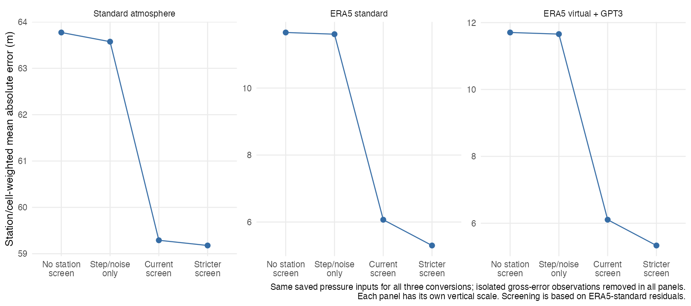
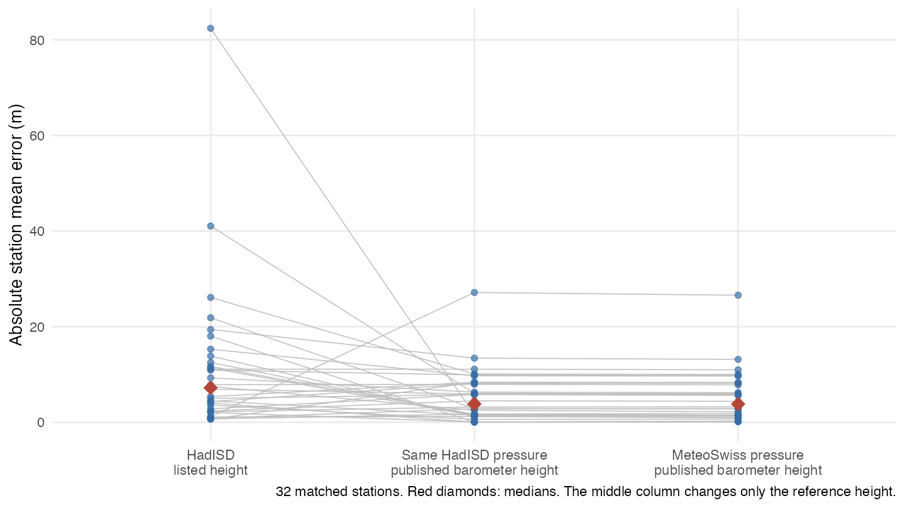

# T06 — Simpler reporting, sampling and reference-quality assessment

**Implementation follow-up:** The author approved these recommendations; see the [implementation and verification record](implementation.md). The assessment and diagnostic numbers below describe the pre-implementation protocol and are retained for traceability.

Assessment dated 18 October 2026. This extends T06 to the author's request to review S1, station filtering, altitude-related sampling and an appendix role for MeteoSwiss. All comparisons use existing observations. The manuscript, figures and primary numerical tables have not been changed. The [shorter S1 draft](../../manuscript/s1-simplification-proposal.md) is ready for review alongside the decisions below.

## Recommendation

Simplify the explanation substantially, keep the existing spatial sample, retain a transparent reference-quality assessment, and move MeteoSwiss's detailed comparison to the appendix. A new global resampling/download campaign is not justified by these results. A limited rebuild from cached observations can fix duplicate hours and make the ground cell weighting exact, with explicit flight-weight definitions and sensitivity tables preserving the distinction between a robust result and an accurately known reference.

The paper's central story remains supported: using weather conditions greatly improves on a fixed standard atmosphere; the virtual-temperature/GPT3 correction mainly benefits flight height; ground reference-height uncertainty limits the interpretation of exact absolute-error values. Neither robust metrics nor spatial thinning eliminates the last issue.

## 1. What happens when the ground filters are removed?

The following comparisons use common finite atmospheric inputs for all conversions and remove the same isolated gross-error observations. Existing cell weights are held fixed to isolate station selection.

| HadISD station selection | Stations | Standard-atmosphere MAE | ERA5-standard MAE | Corrected ERA5 MAE | ERA5-standard median station absolute bias | ERA5-standard p95 absolute error |
|---|---:|---:|---:|---:|---:|---:|
| No station screen | 2646 | 63.77 m | 11.66 m | 11.70 m | 2.75 m | 33.62 m |
| Step/noise flags only | 2607 | 63.58 m | 11.61 m | 11.66 m | 2.72 m | 33.20 m |
| Current screen | 2502 | 59.29 m | 6.07 m | 6.11 m | 2.55 m | 20.45 m |

There are 106 offset flags, 32 step flags and seven noisy-station flags, with overlap between one offset and step flag. Most of the change in MAE comes from excluding the 105 stations flagged only for a persistent offset. Step/noise exclusions alone barely change the pooled MAE. Reinstating isolated gross observations within the currently retained stations changes ERA5-standard MAE from 6.0686 to 6.0760 m, although those checks still make scientific and practical sense.

**The answer to the robust-metric question is qualified.** The median station absolute bias is stable, and the individual-error median also changes little: 3.73 m with the current screen versus 3.98 m without the station screen. However, MAE is not an outlier-proof statistic, and p95 is deliberately sensitive to the tail. They change substantially here. A wrong constant reference height affects every record at a station, so discarding isolated extreme observations does not repair it. Replacing MAE with a median would change the question being answered; it would not establish which altitude reference is correct.

The current offset rule also selects stations using the ERA5-standard residual being evaluated. A large residual can arise from reference metadata, pressure error or atmospheric-conversion error; its size alone does not identify the cause. Therefore it is inappropriate to describe every excluded station as a proven height error or to call the screened 6.1 m an unconditional global conversion accuracy. The Swiss height-only comparison below supplies separate evidence for a real metadata problem, without proving the diagnosis at every excluded station.

**Keep:** finite/physically valid inputs, simple gross-error flags, transparent step/noise checks, and an offset-screen sensitivity. **Change the presentation:** call the latter a reference-plausibility screen, disclose that it uses ERA5 residuals, and show the result without it. Do not tighten the threshold to obtain a better score. The matched-cohort stricter and looser screens give ERA5-standard MAEs of 5.30 and 7.12 m; this is material dependence of the numerical estimate on the rule, not uncertainty resolved by picking one threshold.

A concise main-text sentence can retain the scientific point: “ERA5 reduced ground MAE from 59.3 to 6.1 m in the screened reference set; retaining all eligible stations gave 63.8 and 11.7 m, respectively. Exact absolute errors therefore depend on reference quality, but the benefit of a weather reference is clear.” Detailed thresholds, alternative bounds and diagnostics belong in S4. The unscreened comparison remains subject to the common input/observation-quality checks; it is not a comparison with completely unprocessed data.



Each panel has a different vertical scale. Screening is based on the ERA5-standard discrepancy and affects all three conversions' common station selection. Values and counts are from [ground filter/weighting contrasts](ground_filter_weighting.csv) and [exact individual-error percentiles](ground_filter_tails.csv). Unlike the older sensitivity table, the strict/loose comparisons here also apply the noisy-station exclusion.

## 2. Spatial subsampling is useful; another full draw is unnecessary

| Retained network | Stations | Occupied 2° cells | Cells containing multiple stations | Largest station count in a cell |
|---|---:|---:|---:|---:|
| HadISD | 2502 | 2179 | 180 | 17 |
| IGRA | 648 | 648 | 0 | 1 |

For radiosondes the author's intuition was correct: no retained stations share a 2° cell. Cell and station weighting are equivalent for this selected network. This removes the need for a complicated spatial-weight explanation in the flight Methods.

For HadISD, the high-elevation exception creates multiple sites in some cells. Equal station weighting gives ERA5-standard ground MAE 6.49 m; equal cell weighting recomputed after screening gives 6.08 m; the current inherited cell weights give 6.07 m. The distinction has a modest numerical effect and does not change the ranking. Current weights were assigned before final screening; some surviving cells consequently sum to less than one. Recomputing weights after the final selection is clearer and matches the wording “equal cells.”

Two hundred seeded one-station-per-retained-cell draws give ERA5-standard MAE 5.99–6.19 m, with central 95% of draws at 6.02–6.15 m. This is a resampling range within the existing eligible pool, not an accuracy confidence interval and not a test of every initially unselected station. The same draws reduce the number of >1000 m stations from 570 to 281–305. Dropping the extra stations buys little simplification in the numerical workflow and loses useful terrain/elevation coverage.

**Recommendation:** retain the existing spatial sample and its high-elevation additions, normalise cell weights after final QC, and describe the rule once. Do not rerun station selection merely to make the global metric slightly smaller. Equal 2° cells improve spatial balance; they do not represent equal Earth-surface areas or a random sample of the world's bird habitats.

See [cell counts](cell_counts.csv), [cell summary](cell_summary.csv) and [one-station draw summary](one_station_draw_summary.csv).

### GNSS duplicate hours have a negligible effect on these summaries

The comparison holds the 47 retained stations and existing gross-observation selection fixed, then averages repeated station-hour inputs before applying the conversions. Rows decrease from 1,097,549 to 1,077,297.

| Conversion | Current GNSS MAE | One value per station-hour MAE |
|---|---:|---:|
| Standard atmosphere | 61.7844 m | 61.7831 m |
| ERA5 standard | 5.3625 m | 5.3644 m |
| ERA5 virtual + GPT3 | 5.3273 m | 5.3300 m |

The largest MAE change is 0.0027 m. ERA5-based p95 changes are below 0.008 m. This supports fixing duplicate handling as a small data-processing correction rather than a reason to redraw the networks. A production rebuild should apply unique-hour handling before recomputing final station coverage and QC, rather than silently treating the diagnostic as an already-updated primary result. See [GNSS duplicate sensitivity](gnss_duplicate_sensitivity.csv).

## 3. Altitude-specific sampling: separate three different issues

Station elevation above sea level, local terrain roughness, and flight height above the sounding surface are different quantities. A >1000 m station is not automatically a rough-terrain station, and selecting high stations does not balance the airborne height distribution.

There is no evidence here that we need a new station sample balanced among elevation classes. Keep elevation/terrain breakdowns as explanatory checks and retain existing high-elevation sites. For airborne comparisons, retain height bands and report their support; do not draw equal numbers of raw levels per height merely to make counts uniform. Bird-height weights then address a separate ecological target, unchanged in this T06 assessment.

**The real airborne sampling issue is unequal support within station–height bands.** There are 507–642 represented stations per band, but some station–bands contain only one sounding. For example, 126 of 530 stations in the 250–500 m band and 149 of 578 in the 1.5–2 km band have fewer than 30 soundings in that band. Abundant standard-pressure levels and sparse intermediate levels create an irregular vertical sampling pattern. The extraction also retains pressures ≥400 hPa: this is not a perfectly uniform 6 km-above-surface window, especially at high launch elevations. Neither extra spatial thinning nor a robust scalar error metric fixes these support differences.

### What the current flight weights actually mean

The current code gives a station a cell weight, divides it among all its available levels, and subsequently computes each height-band result. Consequently a station's contribution to a band depends on the fraction of its retained levels that falls in that band. This is not exactly equal station weighting within a band. The current figure's station medians and the pooled individual-error summaries also use different aggregations; these should be described explicitly rather than treated as the same statistic.

Normalising station weights separately within each height band is a simpler comparison target, but assigning equal weight to a station represented by one sounding can be unstable. Equal sounding weights within each station-band additionally reduce the influence of profiles containing many vertical levels. Neither change should be adopted without a support check.

| Flight weighting, using the same bird-height weights | Standard-atmosphere MAE | ERA5-standard bias / MAE | Corrected ERA5 bias / MAE |
|---|---:|---:|---:|
| Current | 41.20 m | −11.82 / 16.44 m | −3.18 / 13.12 m |
| Equal stations within each band | 39.26 m | −11.56 / 16.24 m | −2.99 / 13.17 m |
| Equal stations, equal soundings within each band | 39.72 m | −11.71 / 16.42 m | −3.00 / 13.35 m |

The core correction benefit survives. However, this does not establish that all height-specific tails are insensitive: corrected-ERA5 p95 at 4–5 km changes from about 190.2 to 234.5 m under equal-station band weights. Large upper-band sensitivity must be reported even when bird-weighted averages change little.

### Do minimum sounding counts justify a new altitude-specific filter?

We tested equal station weights within each band with minima of 1, 30 and 100 distinct soundings, keeping each conversion and the bird-height weights unchanged.

| Minimum soundings per station–band | ERA5-standard bird-weighted bias / MAE | Corrected ERA5 bird-weighted bias / MAE | Stations at 250–500 m | Stations at 4–5 km |
|---|---:|---:|---:|---:|
| 1 | −11.56 / 16.24 m | −2.99 / 13.17 m | 530 | 507 |
| 30 | −11.79 / 16.08 m | −2.94 / 12.90 m | 404 | 365 |
| 100 | −11.69 / 15.87 m | −2.85 / 12.64 m | 289 | 278 |

These are different contributing station samples, not increasing levels of truth. In particular, corrected-ERA5 p95 at 4–5 km is 234.5, 265.4 and 245.0 m under the three thresholds. Filtering sparse bands does not monotonically reduce the discrepancy, and a 100-sounding threshold removes almost half the represented stations in some bands. Coverage reflects the archive's reporting structure as well as sample size.

**Recommendation: do not add a new altitude-specific station filter or change the primary flight weights in this revision merely for simplicity.** Retain the existing station-normalised level weights, describe their denominator accurately, and include the equal-station/equal-sounding and minimum-coverage comparisons in the appendix. Report station/sounding support by height and qualify upper-altitude tail values as sensitive to sampling. A claim about a typical equally weighted station in every height band would require explicitly choosing that new target; it is not just a harmless simplification of the existing statistic. Interpolating every sounding to a common height grid would introduce a separate reference-construction assumption and has not been tested here.

The stable finding is the correction's bird-weighted bias/MAE benefit. It does not license claiming that the precise p95 at every height is insensitive to methodology. [Minimum-coverage comparisons](flight_bin_minimum_sensitivity.csv) and [bird-weighted results](flight_bin_minimum_bird.csv) retain the full contrasts. See [flight weighting](flight_weighting.csv), [changes by band](flight_weighting_changes.csv), [bird-weighted contrasts](flight_weighting_bird.csv) and [station-band support](flight_sampling_bin.csv). The tests reuse existing height weights and do not address T07's species, duration or low-flight selection questions.

## 4. MeteoSwiss is most useful as an appendix validation

Yes: move the network-specific Methods, comparative rows and regional map/plot out of the main presentation. Keep a short main-text pointer to the result because it directly explains why reference heights matter.

The previous comparison changed both the pressure archive and the reference height. T06 now also changes **only the height subtracted from the same HadISD altitude series**, leaving the pressure data, timestamps and conversion untouched:

| Reference at the 32 matched stations | Median absolute station bias | Mean absolute station bias |
|---|---:|---:|
| HadISD pressure, listed HadISD height | 7.21 m | 11.49 m |
| Same HadISD pressure, published barometer height | 3.83 m | 5.38 m |
| MeteoSwiss pressure, published barometer height | 3.81 m | 5.32 m |

The remaining median absolute difference between the last two signed biases is only 0.10 m. This strengthens the interpretation that reference-height metadata explain much of the discrepancy at these matched sites. It is a height-only counterfactual using published metadata, not proof that every historical reference height is exact or that every outlier worldwide has the same cause.



Suggested main-text pointer: “A comparison at 32 Swiss stations showed that replacing listed station elevation with published barometer height in the same pressure records reduced median absolute bias from 7.2 to 3.8 m (S4), illustrating the importance of reference-height metadata.” S4 should retain the full comparison, screening sensitivity and datum/assimilation limitations. Removing the dataset from the study would lose useful evidence; moving it to the appendix preserves the evidence and simplifies the main story.

## 5. Reduce the metric hierarchy

| Scientific question | Retain prominently | Secondary/supporting output |
|---|---|---|
| How large is an individual conversion discrepancy? | MAE; p95 absolute error for the tail | RMSE and multiple exceedance thresholds in the supplement |
| Is there a persistent ground offset or weather-related scatter? | Median station absolute bias and station SD in the existing mechanism figure or a short sentence | Separate p90 columns and repeated percentile summaries outside the main table |
| Does the flight correction remove systematic underestimation? | Signed flight bias and MAE by height; bird-weighted bias/MAE as the summary | RMSE, full-band p95 and climatic detail in the supplement |
| How much do unknown reference heights influence the ground result? | One sentence showing screened versus unscreened MAE and the appendix height check | Full threshold grid, station flags and supporting metadata in S4/code |

Use one ground table for the three conversions, with HadISD as the global evaluation and GNSS as complementary height-checked corroboration; report MAE and p95. Move MeteoSwiss rows to S4. Keep signed bias/MAE as the flight table's consistent pair; do not mix bias/RMSE in some columns and bias/MAE in another without a clear reason. Keep station bias/SD as an explanation of the mechanism, rather than repeating four station-summary columns alongside every pooled metric.

Do not describe bias as synonymous with overall accuracy, or change a pre-existing p90 into a p95 by relabelling it. “Median station absolute bias” and “median absolute individual error” are different quantities and should never be abbreviated to an ambiguous “median error.” Ground and flight errors have different vertical references and should retain separate definitions.

For a ground summary with station weights u, each of station s's N retained observations has weight u/N. MAE averages absolute individual errors with these weights; p95 is the corresponding weighted quantile. Station bias is the signed within-station mean; station SD describes scatter about that mean. For a flight-band summary, the station's denominator and eligibility must be defined within that band if that is the intended target. Bird weights subsequently combine bands; they do not turn the station sample into a representative sample of all birds.

## 6. S1 can be much shorter without discarding quality control

The current reference-data/QC prose before the individual-error subsection is approximately 1185 words (inline R values replaced by a single token and code blocks excluded). It combines dataset identity, physical limitations, parsing instructions, legacy implementation quirks and a defence of the reference screen. These need not all occupy the same section.

The [replacement draft](../../manuscript/s1-simplification-proposal.md) keeps 439 words of proposed replacement prose in five short paragraphs plus one compact rules table (about 63% less prose). It preserves product identity, years, spatial/coverage selection, actual filtering criteria, reference-height uncertainty, reported radiosonde heights, time matching and fallback assumptions. It moves the argument for the filters and their sensitivity to S4; MeteoSwiss belongs with that argument. Parsing minutiae, detailed station-year counts and technical provenance remain in the code/audit documentation.

In particular, retain the reason for handling station heights. Remove the implication that the existing offset rule independently identifies bad metadata, and replace “the screen affects only the tail, not the typical error” with a precise statement: the median bias is stable, but MAE and p95 depend materially on screening. Those changes simplify the explanation while making it more accurate.

## 7. Reproduction, scope and next implementation

Run from the project root:

```sh
Rscript docs/methods/T06/compare_designs.R
Rscript docs/methods/T06/assess_bin_coverage.R
Rscript docs/methods/T06/summarise_review.R
```

Only this audit folder is written. [Baseline table hashes](baseline-table-hashes.json) preserve all existing study outputs. [Reproduction checks](reproduction_checks.csv) match the current HadISD and flight MAEs exactly, and GNSS MAEs within 2.8 × 10⁻¹¹ m. The one-cell draws are seeded and describe conditional sampling variability, not confidence intervals. All comparisons are descriptive; none supplies an independent ground-truth altitude or an assimilation experiment.

The recommended next implementation is deliberately limited: use cached observations, resolve unique GNSS hours before final summaries, recompute HadISD cell weights after final selection, retain the current primary flight weights with an accurate description and the new sensitivity appendix, rebuild affected ground/GNSS summaries and graphics, then apply the shorter S1 and appendix allocation. Do not initiate a new full download/resampling campaign or choose filters based on which produces the smallest error. T07 still needs to establish the biological flight population; T08 handles the revised main figures and palette.


The proposed allocation makes HadISD/GNSS ground comparisons and IGRA flight comparisons the main evaluation. MeteoSwiss is a reference-height appendix validation with one main-text pointer. Main metrics are MAE and p95 for ground magnitude/tails, and signed bias/MAE for flight, with station bias/SD retained as mechanism. S1 documents the protocol; S4 supplies the evidence and sensitivity behind reference-quality decisions. This assessment does not authorise treating every unknown reference height as corrected or every remaining discrepancy as pure conversion error.
